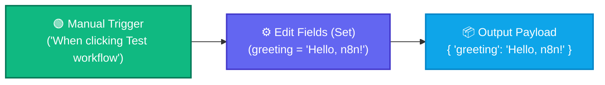

# Topic 1: Create Your First Workflow — "My First N8N Workflow"

> **Institution:** Tayana Academy | LMS Assessment  
> **Topic:** N8N Hands-On Beginner | Topic 1: Create Your First Workflow  
> **Target Audience:** Trainee / Employee  
> **Difficulty Level:** Beginner  
> **Platform Version:** n8n version 1.0.0 or higher  
> **Student:** Abhishek Nikam (`abhishek.n@tayanasolutions.com`)  
> **Repository:** [n8n-assessments](https://github.com/3OOM/n8n-assessments)  

---

## 1. Assessment Overview & Objectives

This hands-on practical assessment demonstrates foundational competency in n8n workflow construction. The objective is to independently create, configure, execute, validate, inspect, and document a clean beginner workflow in n8n from scratch.

### Expected Outcome:
A saved and tested workflow named **`My First N8N Workflow`** that initiates with a **Manual Trigger** node, connects to an **Edit Fields (Set)** node, executes with zero errors, and outputs a structured JSON object containing:
```json
{
  "greeting": "Hello, n8n!"
}
```

---

## 2. Workflow Architecture

The data pipeline runs sequentially from left to right:



---

## 3. Node Specifications & Detailed Configuration

### Node 1: Manual Trigger
- **Node Type:** `n8n-nodes-base.manualTrigger`
- **Display Label:** `When clicking ‘Test workflow’`
- **Purpose:** Serves as the controlled manual entry point for test executions in the n8n canvas.
- **Parameters:** Default settings (no extra input parameters needed).

### Node 2: Edit Fields (Set)
- **Node Type:** `n8n-nodes-base.set` (typeVersion: `3.4`)
- **Display Label:** `Edit Fields (Set)`
- **Operation:** Assign custom fields.
- **Field Name:** `greeting`
- **Field Type:** `String`
- **Field Value:** `Hello, n8n!`
- **Mode:** Keep Only Set (or append without incoming conflict).

---

## 4. Assessment Exercises Completed

### Exercise 1: Open and Prepare Workflow Canvas
- Navigated to the n8n instance and opened the **Workflows** management console.
- Created a fresh blank workflow canvas ready for node placement.

### Exercise 2: Name and Save the Workflow
- Renamed the default untitled workflow to:
  ```text
  My First N8N Workflow
  ```
- Clicked **Save** (`Ctrl+S` / `Cmd+S`) and verified that the title persisted in the top bar.

### Exercise 3: Add the Manual Trigger Node
- Clicked **Add first step** / `+` icon on canvas.
- Selected **"When clicking ‘Test workflow’"** (Manual Trigger).
- Positioned as the foundational starting node on the left.

### Exercise 4: Add and Connect Edit Fields (Set) Node
- Pulled connection connector from the Manual Trigger node to add the next step.
- Selected **Edit Fields (Set)**.
- Verified directional arrow connection establishing left-to-right flow (`Manual Trigger` ➔ `Edit Fields (Set)`).

### Exercise 5: Configure Greeting Payload
- Opened the configuration panel for `Edit Fields (Set)`.
- Under **Fields to Set**, added a field of type **String**.
- Entered Name: `greeting`
- Entered Value: `Hello, n8n!`
- Closed panel and saved settings.

### Exercise 6: Execute and Validate Workflow
- Clicked the **Test workflow** button.
- Both nodes showed green checkmark indicators confirming successful execution.
- Inspected the output in all three required viewer modes:
  1. **Table View:** Column `greeting` displayed with row value `Hello, n8n!`.
  2. **JSON View:** Exact formatted JSON:
     ```json
     {
       "greeting": "Hello, n8n!"
     }
     ```
  3. **Schema View:** Verified schema definition: key `greeting` categorized as primitive `string`.

### Exercise 7: Final Save and Verification
- Saved the workflow. Refreshed canvas and re-verified intact state, names, parameters, and pinned execution state.

### Exercise 8: Documentation and Submission Package
- Exported workflow as JSON: [`My_First_N8N_Workflow.json`](./My_First_N8N_Workflow.json).
- Structured comprehensive `README.md`, screenshots guide, and LMS submission comments.

---

## 5. Output Verification & Data Schema

### Raw JSON Output
```json
[
  {
    "greeting": "Hello, n8n!"
  }
]
```

### Schema Definition
| Field Key | Data Type | Value | Nullable | Required |
| :--- | :--- | :--- | :--- | :--- |
| `greeting` | `string` | `"Hello, n8n!"` | No | Yes |

### Multi-View Validation Matrix
- **Table View:** Displays a 1-column, 1-row table where header is `greeting` and cell is `Hello, n8n!`.
- **JSON View:** Clean key-value object view `{ "greeting": "Hello, n8n!" }`.
- **Schema View:** Validates type inference as `String [1 item]`.

---

## 6. How to Run / Import This Workflow

1. Download [`My_First_N8N_Workflow.json`](./My_First_N8N_Workflow.json).
2. Open your n8n workspace (v1.0.0+).
3. Click the canvas **`...`** (Options menu) ➔ **Import from File...** (or copy contents and paste with `Ctrl+V`).
4. Click **Test workflow** at the bottom of the canvas.
5. Click the **Edit Fields (Set)** node to inspect the output.

---

## 7. Evidence & Screenshots

Screenshots showcasing execution and verification are stored in the [`screenshots/`](./screenshots/) directory:

| Screenshot File | Description | Check |
| :--- | :--- | :---: |
| [`01_workflow_canvas.png`](./screenshots/README.md#screenshot-1) | Full canvas showing workflow name "My First N8N Workflow" and connected nodes | ✅ |
| [`02_node_configuration.png`](./screenshots/README.md#screenshot-2) | Configuration modal of Edit Fields (Set) showing field `greeting` and value `Hello, n8n!` | ✅ |
| [`03_execution_success.png`](./screenshots/README.md#screenshot-3) | Canvas after running "Test workflow" showing green execution success checkmarks | ✅ |
| [`04_output_json_table_schema.png`](./screenshots/README.md#screenshot-4) | Output inspector showing JSON `{ "greeting": "Hello, n8n!" }`, Table, and Schema tabs | ✅ |

*(See [screenshots/README.md](./screenshots/README.md) for full visual capture guide).*

---

## 8. Practical Assessment Checklist

- [x] Opened a blank n8n workflow canvas.
- [x] Named the workflow **“My First N8N Workflow”**.
- [x] Added the **Manual Trigger** node as the first node.
- [x] Added the **Edit Fields (Set)** node as the action node.
- [x] Connected Manual Trigger to Edit Fields (Set).
- [x] Configured a String field named **`greeting`**.
- [x] Set the greeting value to **`“Hello, n8n!”`**.
- [x] Executed the workflow using **Test workflow**.
- [x] Confirmed successful execution of both nodes.
- [x] Validated the output in **Table**, **JSON**, and **Schema** views.
- [x] Saved the final workflow successfully.
- [x] Exported workflow source configuration file (`My_First_N8N_Workflow.json`).
- [x] Prepared screenshots, documentation README, demo script, and public repository structure.

---

## 9. Submission Links

- **Public GitHub Repository:** [https://github.com/3OOM/n8n-assessments](https://github.com/3OOM/n8n-assessments)
- **Topic Folder:** [https://github.com/3OOM/n8n-assessments/tree/main/topic-01-create-your-first-workflow](https://github.com/3OOM/n8n-assessments/tree/main/topic-01-create-your-first-workflow)
- **Video Demonstration:** `[INSERT YOUR LOOM / YOUTUBE URL HERE]` *(Record using the provided [demo-script.md](./demo-script.md))*
