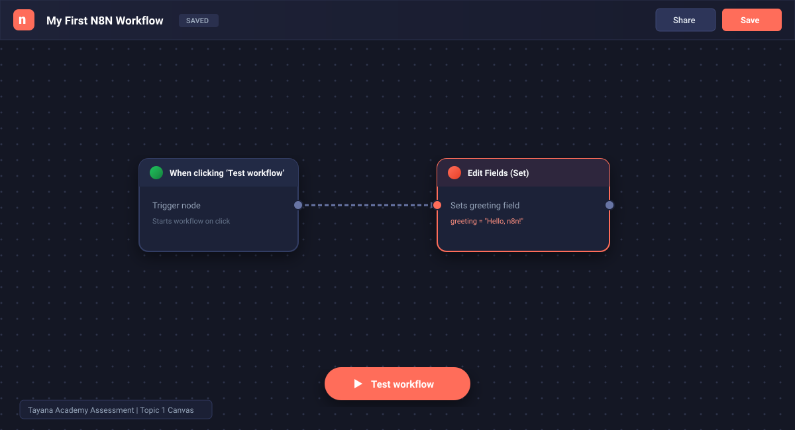
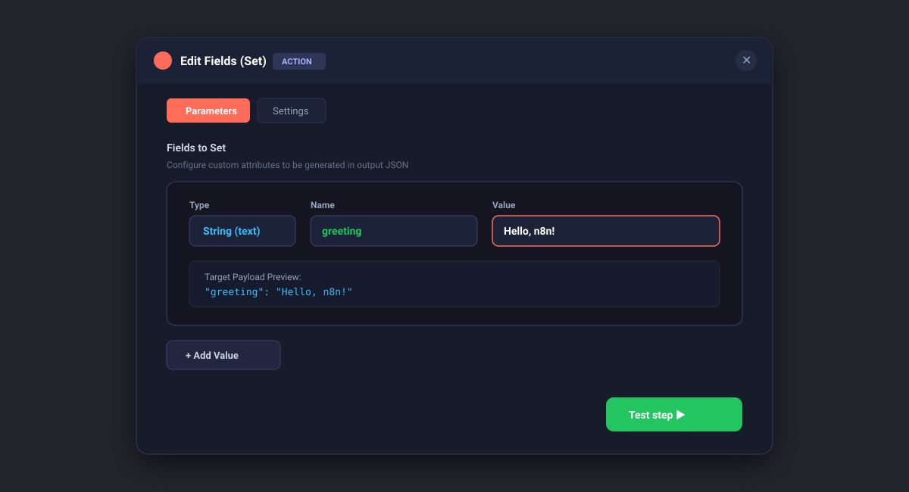
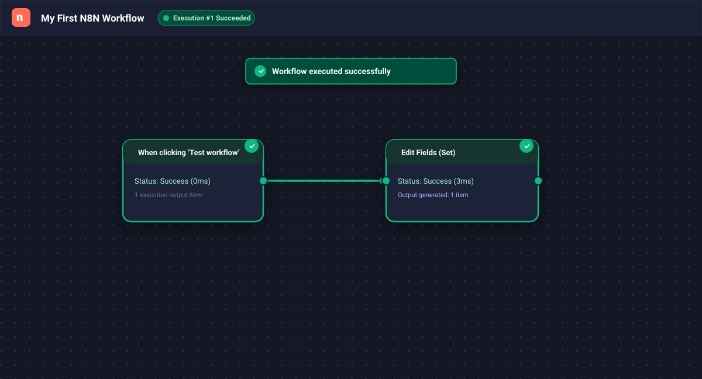
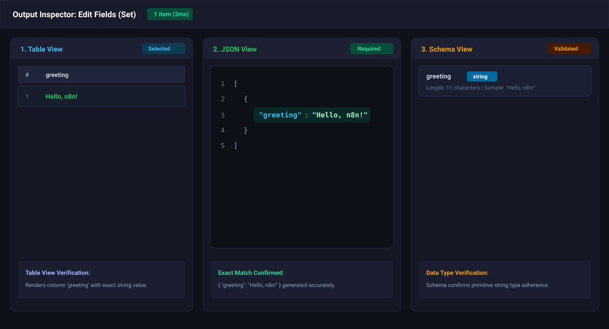

# Assessment Screenshots & Evidence Index

This directory contains visual proof of the workflow implementation, execution, and multi-view validation required by **Tayana Academy Topic 1 Assessment**.

---

### Screenshot 1: Workflow Canvas & Naming
**Description:** Full view of the workflow canvas showing the workflow name `My First N8N Workflow`, the Manual Trigger node, connecting arrow, and the Edit Fields (Set) node.  

---

### Screenshot 2: Node Configuration
**Description:** Configuration modal for `Edit Fields (Set)` confirming the `Fields to Set` settings with type `String`, field name `greeting`, and value `Hello, n8n!`.  

---

### Screenshot 3: Successful Execution
**Description:** Canvas state immediately following clicking **Test workflow**, displaying green checkmarks and success execution state for both nodes.  

---

### Screenshot 4: Output Inspection (Table, JSON, & Schema)
**Description:** Detailed comparison showing the result payload across Table view, the raw JSON object `{"greeting": "Hello, n8n!"}`, and the schema typing inspector.  

---

> **Tip for trainees:** High-fidelity SVG visual captures are pre-rendered above. If taking direct PNG screenshots from your local/cloud browser, save them into this folder as `01_workflow_canvas.png`, `02_node_configuration.png`, `03_execution_success.png`, and `04_output_json_table_schema.png`.
