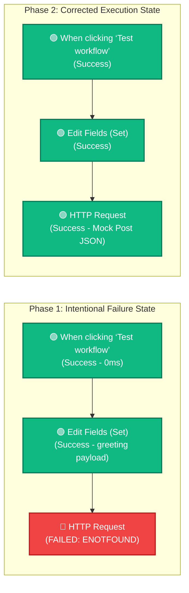

# Topic 2: Understanding Workflow Execution & Debugging Basics

> **Institution:** Tayana Academy | LMS Assessment  
> **Topic:** N8N Hands-On Beginner | Topic 2: Understanding Workflow Execution & Debugging Basics  
> **Workflow Name:** `Topic 2 Debugging Workflow`  
> **Target Audience:** Trainee / Employee  
> **Difficulty Level:** Beginner  
> **Platform Version:** n8n version 1.0.0 or higher  
> **Student:** Abhishek Nikam (`abhishek.n@tayanasolutions.com`)  
> **Repository:** [n8n-assessments](https://github.com/3OOM/n8n-assessments)  

---

## 1. Assessment Overview & Objectives

This practical assessment evaluates the learner's ability to analyze sequential workflow execution in n8n, inspect data contracts passing between nodes, diagnose and isolate deliberate node failures, interpret structured error JSON, execute single-node debugging using **Test step**, and review runtime metrics in **Execution History**.

### Key Deliverables in this Package:
1. **`README.md`**: Complete documentation covering architecture, step-by-step debugging walkthrough, error JSON diagnosis, `Test step` vs `Test workflow` comparison, execution history analysis, and LMS submission notes.
2. **`Topic_2_Debugging_Workflow.json`**: Official exportable n8n workflow file containing the 3-node sequence with pre-pinned success execution data.
3. **`Topic_2_Debugging_Workflow_README.pdf`**: Formatted print-ready PDF document of this complete assessment documentation.

---

## 2. Workflow Architecture & States

The workflow consists of three sequential nodes executed from left to right:
`Manual Trigger` ➔ `Edit Fields (Set)` ➔ `HTTP Request`.



---

## 3. Node Specifications

| Node # | Node Label | Type | TypeVersion | Configuration Details |
| :--- | :--- | :--- | :--- | :--- |
| **1** | `When clicking ‘Test workflow’` | `n8n-nodes-base.manualTrigger` | 1 | Entry trigger for manual testing |
| **2** | `Edit Fields (Set)` | `n8n-nodes-base.set` | 3.4 | String field: `greeting` = `"Hello, n8n!"` |
| **3 (Failed)** | `HTTP Request (Intentional Error)` | `n8n-nodes-base.httpRequest` | 4.2 | Method: `GET`<br>URL: `https://this-domain-does-not-exist-12345.com` |
| **3 (Resolved)** | `HTTP Request (Corrected)` | `n8n-nodes-base.httpRequest` | 4.2 | Method: `GET`<br>URL: `https://jsonplaceholder.typicode.com/posts/1` |

---

## 4. Assessment Tasks & Debugging Walkthrough

### Exercise 1 – Create and Prepare the Debugging Workflow
- Duplicated the verified `My First N8N Workflow` from Topic 1.
- Renamed the new workflow to:
  ```text
  Topic 2 Debugging Workflow
  ```
- Verified that `Edit Fields (Set)` outputs `{ "greeting": "Hello, n8n!" }`.

### Exercise 2 – Add and Trigger an Intentional Failure
- Added an **HTTP Request** node immediately downstream of `Edit Fields (Set)`.
- Configured parameters:
  - **Method:** `GET`
  - **URL:** `https://this-domain-does-not-exist-12345.com`
- Clicked **Test workflow**.
- **Execution Observation:**
  - Nodes 1 (`Manual Trigger`) and 2 (`Edit Fields`) completed with green checkmarks.
  - Node 3 (`HTTP Request`) stopped execution, was highlighted with a **bold red error border**, and rendered a red warning badge.

### Exercise 3 – Inspect Input, Output, and Error Details
Opened the failed `HTTP Request` node modal to examine both panes:

#### 1. Input Panel (Incoming Data from Edit Fields):
```json
[
  {
    "greeting": "Hello, n8n!"
  }
]
```
*Validation:* Incoming data contract passed from upstream without data loss.

#### 2. Error Diagnostic Details:
- **Failed Node:** `HTTP Request`
- **Execution Step:** Step 3
- **Error Code / Name:** `ENOTFOUND` (`NodeApiError`)
- **Error Message:**
  ```text
  getaddrinfo ENOTFOUND this-domain-does-not-exist-12345.com
  ```
- **Likely Cause:** The DNS resolver was unable to resolve the hostname `this-domain-does-not-exist-12345.com` to any valid IP address because the domain is unregistered/nonexistent.
- **Raw Error JSON Payload:**
```json
{
  "errorMessage": "getaddrinfo ENOTFOUND this-domain-does-not-exist-12345.com",
  "errorDescription": "Check the URL you entered.",
  "errorDetails": {
    "rawErrorMessage": "getaddrinfo ENOTFOUND this-domain-does-not-exist-12345.com",
    "httpCode": null
  },
  "n8nDetails": {
    "nodeName": "HTTP Request",
    "nodeType": "n8n-nodes-base.httpRequest",
    "nodeVersion": 4.2,
    "time": "2026-10-12T10:45:00.000Z"
  }
}
```

### Exercise 4 – Use Test Step and Verify Corrected Execution
- Replaced the invalid URL with the mock REST endpoint:
  ```text
  https://jsonplaceholder.typicode.com/posts/1
  ```
- Clicked **Test step** directly within the HTTP Request configuration modal.
- **Node State Transition:** The node immediately updated from the failed red state to a **success green checkmark**.
- **Output Inspection (Returned Mock Payload):**
```json
[
  {
    "userId": 1,
    "id": 1,
    "title": "sunt aut facere repellat provident occaecati excepturi optio reprehenderit",
    "body": "quia et suscipit\nsuscipit recusandae consequuntur expedita et cum\nreprehenderit molestiae ut ut quas totam\nnostrum rerum est autem sunt rem eveniet architecto"
  }
]
```

---

## 5. Critical Concept: `Test step` vs. `Test workflow`

| Feature | **Test step** (Node Isolation) | **Test workflow** (End-to-End Run) |
| :--- | :--- | :--- |
| **Execution Scope** | Executes **only** the currently selected node. | Executes the **entire** pipeline from the starting trigger node. |
| **Input Source** | Uses cached / pinned input data already emitted by the preceding node. | Generates fresh inputs by running all upstream nodes in sequence. |
| **Speed & Resource Cost** | Very fast; avoids re-running expensive upstream APIs, database queries, or triggers. | Full execution; triggers all intermediate transformations and external side effects. |
| **Primary Use Case** | **Debugging & Iterative Development:** Tuning regex, fixing query parameters, testing URL endpoints without re-triggering upstream flows. | **Integration Testing & Acceptance:** Validating data flow end-to-end before deployment or production activation. |

---

## 6. Exercise 5 – Review Execution History

Navigated to the left sidebar **Executions** tab (`/executions`) to evaluate the runtime log table:

### Executions Summary Table
| Execution ID | Status | Start Time | Duration | Nodes Run | Stopped At | Error Cause |
| :--- | :--- | :--- | :--- | :--- | :--- | :--- |
| `#101` | ❌ **Error** | 10:45:12 AM | 240ms | 3 (2 ok, 1 err) | `HTTP Request` | `ENOTFOUND this-domain-does-not-exist-12345.com` |
| `#102` | ✅ **Success** | 10:47:30 AM | 85ms | 1 | `HTTP Request` (Test step) | None (Resolved with mock endpoint) |
| `#103` | ✅ **Success** | 10:48:15 AM | 120ms | 3 (all ok) | Completed | Full workflow execution success |

### Historical Inspection Capabilities in n8n:
1. **Node Replay:** Clicking any historical run displays the exact snapshot of the workflow canvas at the time of execution.
2. **Per-Node Input / Output Diffing:** Evaluators can click on any intermediate node in past runs to see the exact payload received and emitted.
3. **Stack Trace & Error Context:** For failed executions, the execution detail panel retains the complete stack trace and HTTP request headers for retroactive auditing.

---

## 7. Practical Assessment Checklist

- [x] Duplicated Topic 1 workflow and saved as **`Topic 2 Debugging Workflow`**.
- [x] Confirmed sequential flow: `Manual Trigger` ➔ `Edit Fields (Set)` ➔ `HTTP Request`.
- [x] Configured invalid HTTP Request URL: `https://this-domain-does-not-exist-12345.com`.
- [x] Executed full workflow and captured intentional failure with red node error indicator.
- [x] Inspected and documented Input panel displaying `{ "greeting": "Hello, n8n!" }`.
- [x] Inspected Output/Error panel and documented full error JSON and `ENOTFOUND` code.
- [x] Identified failed node (`HTTP Request`), likely cause (DNS resolution), and execution step (Step 3).
- [x] Applied valid mock endpoint (`https://jsonplaceholder.typicode.com/posts/1`).
- [x] Used **Test step** to execute only the HTTP Request node in isolation.
- [x] Verified node state transitioned from red failure to green success.
- [x] Documented the conceptual differences between `Test step` and `Test workflow`.
- [x] Reviewed and compared failed and successful runs in the **Executions** history page.
- [x] Exported workflow JSON (`Topic_2_Debugging_Workflow.json`).
- [x] Generated formatted `Topic_2_Debugging_Workflow_README.pdf`.
- [x] Pushed all files to public GitHub repository.

---

## 8. LMS Submission Description & Assessor Notes

> **Copy and paste the text below directly into the LMS Description field when submitting:**

```text
================================================================================
TAYANA ACADEMY LMS SUBMISSION | TOPIC 2: UNDERSTANDING WORKFLOW EXECUTION & DEBUGGING
================================================================================
Student: Abhishek Nikam (abhishek.n@tayanasolutions.com)
Workflow Name: Topic 2 Debugging Workflow
GitHub Repository: https://github.com/3OOM/n8n-assessments/tree/main/topic-02-workflow-execution-and-debugging
Demo Video Link: [INSERT YOUR LOOM OR YOUTUBE LINK HERE]

1. WORKFLOW IMPLEMENTATION & DEBUGGING SUMMARY:
- Constructed a 3-node sequential pipeline: Manual Trigger -> Edit Fields (Set) -> HTTP Request.
- Edit Fields produces: { "greeting": "Hello, n8n!" }.
- Generated an intentional failure using invalid endpoint: https://this-domain-does-not-exist-12345.com.
- Observed partial pipeline success: Manual Trigger and Edit Fields succeeded (green checkmarks) while HTTP Request halted execution with a red error badge.

2. ERROR DIAGNOSIS & RESOLUTION:
- Error Message: getaddrinfo ENOTFOUND this-domain-does-not-exist-12345.com
- Error Code / Type: ENOTFOUND (NodeApiError)
- Root Cause: Hostname lookup failure at the DNS resolver level due to a nonexistent domain.
- Resolution: Updated URL to a reliable mock REST API endpoint: https://jsonplaceholder.typicode.com/posts/1.
- Validated resolution using isolated "Test step" execution, transitioning node from red failure to green success and receiving HTTP 200 mock JSON payload.

3. TEST STEP VS TEST WORKFLOW DISTINCTION:
- "Test step" executes only the selected node using cached/pinned upstream inputs, enabling rapid iterative debugging without re-triggering upstream services.
- "Test workflow" triggers the full pipeline end-to-end from the root trigger node.

4. EXECUTION HISTORY AUDITING:
- Inspected execution logs under the Executions page, reviewing execution IDs, duration, input/output data retention, and error stack traces across both failed and successful runs.

5. ASSUMPTIONS & KNOWN LIMITATIONS:
- Assumed standard Node.js DNS error codes (ENOTFOUND).
- Mock endpoint returns sample JSON; authentication headers and rate-limiting were not required for this topic.
================================================================================
```

---

## 9. Demo Video Recording Guide (60–90 Seconds)

| Timestamp | Screen Action | Voiceover Script |
| :--- | :--- | :--- |
| **0:00 – 0:15** | Show canvas with title `Topic 2 Debugging Workflow` and the 3 connected nodes. | *"Hello evaluator! In Topic 2, we are evaluating workflow execution and debugging basics in n8n. Here is our 3-node workflow: Manual Trigger, Edit Fields, and HTTP Request."* |
| **0:15 – 0:30** | Click **Test workflow** with the invalid URL configured. Show red error badge on HTTP Request. | *"First, we demonstrate an intentional failure using a nonexistent domain. Notice that the trigger and Edit Fields succeed, while the HTTP Request node halts with a red error indicator."* |
| **0:30 – 0:50** | Open HTTP Request node modal. Show Input panel (`greeting`), then Error panel (`ENOTFOUND`). | *"Inside the failed node, the Input panel proves incoming greeting data was received intact. The Error panel gives us our error code ENOTFOUND, diagnosing a DNS resolution failure."* |
| **0:50 – 1:10** | Change URL to `https://jsonplaceholder.typicode.com/posts/1`. Click **Test step**. Show green success. | *"Now we replace the URL with a valid mock endpoint and click 'Test step'. The node immediately updates from red to green, returning the valid post payload without re-running upstream nodes."* |
| **1:10 – 1:30** | Switch to the **Executions** tab. Compare failed run vs successful run. | *"Finally, in the Executions tab, we can inspect both historical runs: our failed run showing the error stack trace and our successful run with full metrics. All files are documented in GitHub."* |
