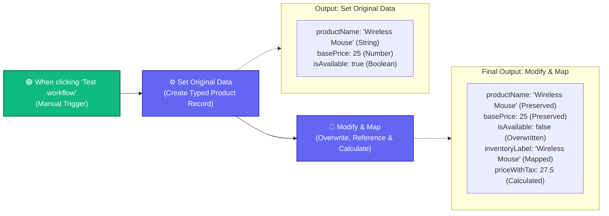

# Topic 3: Working with Core Nodes & Data Mapping

> **Institution:** Tayana Academy | LMS Assessment  
> **Topic:** N8N Hands-On Beginner | Topic 3: Working with Core Nodes & Data Mapping  
> **Workflow Name:** `Topic 3 Core Nodes Workflow`  
> **Target Audience:** Trainee / Employee  
> **Difficulty Level:** Beginner  
> **Platform Version:** n8n version 1.0.0 or higher  
> **Student:** Abhishek Nikam (`abhishek.n@tayanasolutions.com`)  
> **Repository:** [n8n-assessments](https://github.com/3OOM/n8n-assessments)  

---

## 1. Assessment Overview & Objectives

This practical assessment evaluates the learner's capability to create, structure, modify, and dynamically map product data using the core **Edit Fields (Set)** node in n8n. The assessment focuses on strict data typing (String, Number, Boolean), value overwriting, preserving incoming data contracts, and executing dynamic inline expressions for arithmetic calculations and string mapping.

### Key Deliverables in this Package:
1. **`README.md`**: Complete assessment documentation including architecture, node-level configuration, dynamic expression mechanics, schema validation, and LMS submission notes.
2. **`Topic_3_Core_Nodes_Workflow.json`**: Official exportable n8n workflow file ready to import into any n8n v1+ instance.
3. **`README.pdf`**: Print-ready, professionally styled PDF document generated directly from this documentation.

---

## 2. Workflow Architecture & Data Flow

The workflow processes product records in a linear, left-to-right 3-node sequence:



---

## 3. Node Specifications & Detailed Configuration

### Node 1: Manual Trigger
- **Node Label:** `When clicking ‘Test workflow’`
- **Node Type:** `n8n-nodes-base.manualTrigger` (typeVersion: `1`)
- **Purpose:** Entry point for controlled execution and iterative testing on the canvas.

### Node 2: Set Original Data
- **Node Label:** `Set Original Data`
- **Node Type:** `n8n-nodes-base.set` (typeVersion: `3.4`)
- **Fields to Set:**
  | Field Name | Data Type | Assigned Value | Description |
  | :--- | :--- | :--- | :--- |
  | `productName` | `String` | `"Wireless Mouse"` | Product catalogue title |
  | `basePrice` | `Number` | `25` | Base retail unit price |
  | `isAvailable` | `Boolean` | `true` | Initial availability stock flag |

### Node 3: Modify & Map
- **Node Label:** `Modify & Map`
- **Node Type:** `n8n-nodes-base.set` (typeVersion: `3.4`)
- **Include Other Input Fields:** `true` (ensures unedited upstream fields `productName` and `basePrice` are preserved)
- **Fields to Set / Overwrite:**
  | Field Name | Data Type | Value / Expression | Behavior |
  | :--- | :--- | :--- | :--- |
  | `isAvailable` | `Boolean` | `false` | **Overwrites** incoming `true` flag |
  | `inventoryLabel` | `String` | `={{ $json.productName }}` | **Dynamically maps** from `productName` |
  | `priceWithTax` | `Number` | `={{ $json.basePrice * 1.1 }}` | **Calculates** base price + 10% tax |

---

## 4. Assessment Tasks & Step-by-Step Walkthrough

### Exercise 1 – Create and Save the Workflow Structure
- Created a fresh blank workflow canvas.
- Renamed the workflow to:
  ```text
  Topic 3 Core Nodes Workflow
  ```
- Saved the workflow (`Ctrl+S` / `Cmd+S`) before adding nodes.
- Verified directional layout: `Manual Trigger` ➔ `Set Original Data` ➔ `Modify & Map`.

### Exercise 2 – Create the Initial Typed Product Record
- Placed the first Edit Fields (Set) node and renamed it to **`Set Original Data`**.
- Added three typed attributes under **Fields to Set**:
  - `productName` (String): `"Wireless Mouse"`
  - `basePrice` (Number): `25`
  - `isAvailable` (Boolean): `true`
- Ran **Test step** on this node.
- **Verification:** Verified in Schema view that all three fields emerged with correct primitive types.

### Exercise 3 – Modify Existing Data and Map an Incoming Value
- Placed the second Edit Fields (Set) node and renamed it to **`Modify & Map`**.
- Toggled **Include Other Input Fields** to `true` (or kept default input preservation).
- Configured field overwrite:
  - Added Boolean field `isAvailable` with value `false`.
- Configured dynamic field mapping:
  - Added String field `inventoryLabel`.
  - Switched input mode to **Expression**.
  - Entered: `{{ $json.productName }}`.
  - *Validation:* The preview pane immediately evaluated to `"Wireless Mouse"`.

### Exercise 4 – Create and Validate the Calculated Field
- Under **Modify & Map**, added a new Number field named `priceWithTax`.
- Switched input mode to **Expression**.
- Entered arithmetic expression:
  ```javascript
  {{ $json.basePrice * 1.1 }}
  ```
- Executed the complete workflow via **Test workflow**.
- **Result:** Both nodes executed with green checkmarks (0 errors).
- Evaluated final payload: `25 * 1.1 = 27.5`.

### Exercise 5 – Document, Demonstrate, and Submit the Solution
- Exported the completed workflow as [`Topic_3_Core_Nodes_Workflow.json`](./Topic_3_Core_Nodes_Workflow.json).
- Generated publication PDF [`README.pdf`](./README.pdf).
- Updated centralized public repository index at `3OOM/n8n-assessments`.

---

## 5. Output Verification & Multi-View Inspection

### Final Verified JSON Output Payload
```json
[
  {
    "productName": "Wireless Mouse",
    "basePrice": 25,
    "isAvailable": false,
    "inventoryLabel": "Wireless Mouse",
    "priceWithTax": 27.5
  }
]
```

### Multi-View Inspection Matrix

| View Mode | What Evaluator Sees | Verification Criteria Met |
| :--- | :--- | :--- |
| **Table View** | 5 visible columns: `productName`, `basePrice`, `isAvailable`, `inventoryLabel`, `priceWithTax`. Row displays `Wireless Mouse \| 25 \| false \| Wireless Mouse \| 27.5`. | Clean tabular representation of transformed product row. |
| **JSON View** | Clean key-value JSON structure with exact property names and values matching assessment criteria. | Exact match: `isAvailable: false`, `priceWithTax: 27.5`. |
| **Schema View** | • `productName` : `string`<br>• `basePrice` : `number`<br>• `isAvailable` : `boolean`<br>• `inventoryLabel` : `string`<br>• `priceWithTax` : `number` | Confirms strict type adherence across all 5 properties. |

---

## 6. Deep Dive: Dynamic Expressions vs. Hardcoding

### 1. Dynamic Reference (`inventoryLabel`):
- **Hardcoding (Incorrect):** Entering `"Wireless Mouse"` manually makes the workflow brittle. If upstream product changes to `"Mechanical Keyboard"`, the label remains stuck.
- **Dynamic Expression (Implemented):** Using `{{ $json.productName }}` guarantees that downstream labeling always updates adaptively in real time.

### 2. Arithmetic Expression (`priceWithTax`):
- **Calculation Formula:** `{{ $json.basePrice * 1.1 }}`
- In n8n, expressions are evaluated inside JavaScript curly brace delimiters `{{ ... }}`.
- Because `basePrice` was configured with primitive type `number` (`25`), the arithmetic multiplier `1.1` performs float multiplication, producing `27.5`.

### 3. Preserving Upstream Fields:
- By enabling **Include Other Input Fields**, n8n merges incoming properties with modified ones.
- Since `isAvailable` was declared in both nodes, the second node takes precedence, successfully overwriting `true` with `false` while leaving `productName` and `basePrice` intact.

---

## 7. Practical Assessment Checklist

- [x] Workflow created and named **`Topic 3 Core Nodes Workflow`**.
- [x] Manual Trigger node added as initial canvas node.
- [x] First Edit Fields node added and renamed to **`Set Original Data`**.
- [x] `productName` configured as **String** with value `"Wireless Mouse"`.
- [x] `basePrice` configured as **Number** with value `25`.
- [x] `isAvailable` initially configured as **Boolean** `true`.
- [x] Second Edit Fields node added and renamed to **`Modify & Map`**.
- [x] `isAvailable` successfully overwritten from `true` to `false`.
- [x] `inventoryLabel` dynamically mapped via `{{ $json.productName }}` without hardcoding.
- [x] `priceWithTax` calculated via `{{ $json.basePrice * 1.1 }}` yielding `27.5`.
- [x] Verified all 5 fields present in final JSON payload.
- [x] Workflow executed with 100% success rate and zero errors.
- [x] Exported workflow JSON source file (`Topic_3_Core_Nodes_Workflow.json`).
- [x] Rendered formatted print PDF (`README.pdf`).
- [x] Pushed all deliverables to public GitHub repository.

---

## 8. LMS Submission Description & Assessor Notes

> **Copy and paste the text below directly into the LMS Description field when submitting:**

```text
================================================================================
TAYANA ACADEMY LMS SUBMISSION | TOPIC 3: WORKING WITH CORE NODES & DATA MAPPING
================================================================================
Student Name: Abhishek Nikam
Student Email: abhishek.n@tayanasolutions.com
Workflow Name: Topic 3 Core Nodes Workflow
GitHub Repository: https://github.com/3OOM/n8n-assessments/tree/main/topic-03-core-nodes-and-data-mapping
Demo Video Link: [INSERT YOUR LOOM OR YOUTUBE LINK HERE]

1. WORKFLOW IMPLEMENTATION SUMMARY:
- Constructed a 3-node sequential pipeline: Manual Trigger -> Set Original Data -> Modify & Map.
- "Set Original Data" creates a strictly-typed initial record:
  * productName (String): "Wireless Mouse"
  * basePrice (Number): 25
  * isAvailable (Boolean): true
- "Modify & Map" preserves incoming keys while performing updates and transformations:
  * isAvailable (Boolean): Overwritten from true to false
  * inventoryLabel (String): Dynamically mapped using {{ $json.productName }}
  * priceWithTax (Number): Calculated with 10% tax using {{ $json.basePrice * 1.1 }}
- Resulting output contains all 5 required fields: productName, basePrice, isAvailable (false), inventoryLabel ("Wireless Mouse"), and priceWithTax (27.5).

2. KEY TECHNICAL HIGHLIGHTS & EXPRESSIONS:
- Dynamic Expression Mapping: Leveraged {{ $json.productName }} instead of hardcoded strings to ensure automated data propagation.
- Inline Mathematical Transformation: Used {{ $json.basePrice * 1.1 }} within a Number type field to compute tax seamlessly.
- State & Field Preservation: Utilized "Include Other Input Fields" to prevent dropping upstream attributes during intermediate mutations.

3. VERIFICATION ACROSS MULTI-VIEW MODES:
- Table View: Verified all 5 columns render with clean data values.
- JSON View: Confirmed payload strictly conforms to the expected 5-property object.
- Schema View: Validated data types (string, number, boolean, string, number) are preserved without unwanted string coercions.

4. ASSUMPTIONS & KNOWN LIMITATIONS:
- Single product record processed per execution.
- Assumes valid numeric input in basePrice for mathematical operations.
================================================================================
```

---

## 9. Demo Video Recording Guide (60–90 Seconds)

| Timestamp | Screen Action | Voiceover Script |
| :--- | :--- | :--- |
| **0:00 – 0:15** | Show canvas with title `Topic 3 Core Nodes Workflow` and 3 connected nodes: Manual Trigger ➔ Set Original Data ➔ Modify & Map. | *"Hello evaluator! In Topic 3, we are demonstrating core node configuration and dynamic data mapping in n8n. Here is our 3-node workflow on the canvas."* |
| **0:15 – 0:35** | Open `Set Original Data` modal. Point out String `productName`, Number `basePrice`, and Boolean `isAvailable`. | *"Opening 'Set Original Data', we see our typed initial fields: productName as String 'Wireless Mouse', basePrice as Number 25, and isAvailable as Boolean true."* |
| **0:35 – 0:55** | Open `Modify & Map` modal. Highlight `isAvailable` overwritten to `false`, `inventoryLabel` with `{{ $json.productName }}`, and `priceWithTax` with `{{ $json.basePrice * 1.1 }}`. | *"In 'Modify & Map', we overwrite isAvailable to false, dynamically map inventoryLabel from productName using an expression, and compute priceWithTax using basePrice times 1.1."* |
| **0:55 – 1:15** | Click **Test workflow**. Open final node output. Toggle Table, JSON, and Schema views. Point out `priceWithTax: 27.5`. | *"Running Test workflow, both nodes succeed instantly. In JSON view, we have all five fields with priceWithTax equal to 27.5. Schema view confirms all data types."* |
| **1:15 – 1:30** | Show GitHub repository and PDF documentation. Wrap up. | *"All deliverables, including the JSON workflow export and generated PDF documentation, are published to our public GitHub repo. Thank you!"* |
