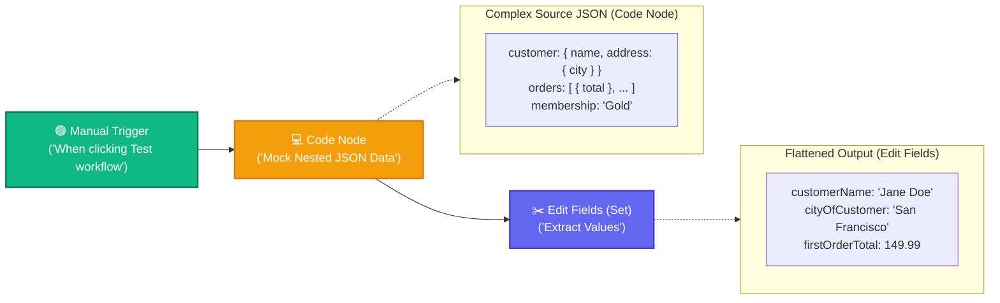

# Topic 4: Working with JSON Objects, Arrays & Expressions

> **Institution:** Tayana Academy | LMS Assessment  
> **Topic:** N8N Hands-On Beginner | Topic 4: Working with JSON Objects, Arrays & Expressions  
> **Workflow Name:** `Topic4_JSON_Data_Assessment`  
> **Target Audience:** Trainee / Employee  
> **Difficulty Level:** Beginner  
> **Platform Version:** n8n version 1.0.0 or higher  
> **Student:** Abhishek Nikam (`abhishek.n@tayanasolutions.com`)  
> **Repository:** [n8n-assessments](https://github.com/3OOM/n8n-assessments)  

---

## 1. Assessment Overview & Objectives

This practical assessment evaluates the learner's capability to generate, inspect, navigate, and transform complex hierarchical JSON structures in n8n. The assessment focuses on distinguishing JSON objects from arrays, using dot notation and zero-based bracket indexing in n8n expressions, preserving native data types across transformations, and delivering a clean, simplified output schema.

### Key Deliverables in this Package:
1. **`README.md`**: Comprehensive assessment documentation covering architecture, JavaScript mock generation, expression mechanics, multi-view inspection, and LMS submission notes.
2. **`Topic4_JSON_Data_Assessment.json`**: Official exportable n8n workflow file ready to import into any n8n v1+ instance.
3. **`README.pdf`**: Print-ready, professionally styled PDF document generated directly from this documentation.

---

## 2. Workflow Architecture & Data Pipeline

The workflow executes in a linear 3-node sequence from left to right:



---

## 3. Node Specifications & Detailed Configuration

### Node 1: Manual Trigger
- **Node Label:** `When clicking ‘Test workflow’`
- **Node Type:** `n8n-nodes-base.manualTrigger` (typeVersion: `1`)
- **Purpose:** Entry trigger for controlled execution and testing on the editor canvas.

### Node 2: Code Node (`Mock Nested JSON Data`)
- **Node Label:** `Mock Nested JSON Data`
- **Node Type:** `n8n-nodes-base.code` (typeVersion: `2`)
- **Language:** JavaScript
- **Code Snippet:**
```javascript
return [
  {
    json: {
      customer: {
        id: "CUST-8492",
        name: "Jane Doe",
        email: "jane.doe@example.com",
        address: {
          street: "123 Market Street",
          city: "San Francisco",
          state: "CA",
          postalCode: "94105",
          country: "USA"
        }
      },
      orders: [
        {
          orderId: "ORD-1001",
          item: "Ergonomic Keyboard",
          quantity: 1,
          total: 149.99,
          status: "completed"
        },
        {
          orderId: "ORD-1002",
          item: "Wireless Mouse",
          quantity: 2,
          total: 50.00,
          status: "shipped"
        }
      ],
      membership: "Gold",
      status: "active"
    }
  }
];
```

### Node 3: Edit Fields (Set) Node (`Extract Values`)
- **Node Label:** `Extract Values`
- **Node Type:** `n8n-nodes-base.set` (typeVersion: `3.4`)
- **Include Other Input Fields:** `false` (produces a clean, simplified output containing only the extracted properties)
- **Extracted Fields & Expressions:**
  | Output Field Name | Data Type | Expression Syntax | Value Source / Path | Result Value |
  | :--- | :--- | :--- | :--- | :--- |
  | `customerName` | `String` | `={{ $json.customer.name }}` | Dot notation into object `customer` | `"Jane Doe"` |
  | `cityOfCustomer` | `String` | `={{ $json.customer.address.city }}` | Nested dot notation into `customer.address` | `"San Francisco"` |
  | `firstOrderTotal` | `Number` | `={{ $json.orders[0].total }}` | Array index `[0]` into `orders` array | `149.99` |

---

## 4. Assessment Tasks & Step-by-Step Walkthrough

### Exercise 1 – Create and Name the Assessment Workflow
- Created a fresh blank workflow canvas.
- Renamed the workflow exactly to:
  ```text
  Topic4_JSON_Data_Assessment
  ```
- Added the `Manual Trigger` node and saved the workflow before proceeding.

### Exercise 2 – Generate Nested Customer JSON Data
- Placed a `Code` node immediately following the trigger and renamed it to **`Mock Nested JSON Data`**.
- Implemented JavaScript code returning:
  1. A nested `customer` object containing customer attributes and a nested `address` sub-object.
  2. An `orders` array containing two order objects with `orderId`, `item`, `quantity`, `total`, and `status`.
  3. Single-value fields: `membership` (`"Gold"`) and `status` (`"active"`).
- Executed node and validated that n8n parses the structure as valid JSON.

### Exercise 3 – Inspect Objects, Arrays, and Data Types
- Opened output panel of `Mock Nested JSON Data` across all three view modes:
  - **JSON View:** Inspected curly braces `{}` representing key-value objects and square brackets `[]` representing indexed arrays.
  - **Table View:** Observed nested structures rendered as collapsed object pills (`[Object]`, `[Array]`).
  - **Schema View:** Verified inferred types: `customer` (Object), `customer.name` (String), `orders` (Array of Objects), `orders[].total` (Number).
- Confirmed zero-based array indexing: the first order (`ORD-1001`) resides at index `0`.

### Exercise 4 – Extract Nested Values Using Expressions
- Added an `Edit Fields (Set)` node and renamed it to **`Extract Values`**.
- Configured three targeted attributes using n8n expression mode:
  1. `customerName`: `={{ $json.customer.name }}` (type: String)
  2. `cityOfCustomer`: `={{ $json.customer.address.city }}` (type: String)
  3. `firstOrderTotal`: `={{ $json.orders[0].total }}` (type: Number)
- Verified that all fields utilize dynamic expression binding rather than hardcoded string literals.

### Exercise 5 – Execute, Validate, Document, and Submit
- Executed the complete workflow end-to-end via **Test workflow**.
- Verified all three nodes completed successfully with green checkmarks.
- Confirmed the final output schema contains exactly the three extracted fields with correct native types.
- Exported workflow JSON file: [`Topic4_JSON_Data_Assessment.json`](./Topic4_JSON_Data_Assessment.json).
- Generated publication PDF: [`README.pdf`](./README.pdf).
- Updated repository portfolio at `3OOM/n8n-assessments`.

---

## 5. Final Output Payload & Multi-View Verification

### Final Transformed Output JSON
```json
[
  {
    "customerName": "Jane Doe",
    "cityOfCustomer": "San Francisco",
    "firstOrderTotal": 149.99
  }
]
```

### Multi-View Inspection Matrix

| View Mode | What Evaluator Observes | Verification Criteria |
| :--- | :--- | :--- |
| **Table View** | 3 columns: `customerName`, `cityOfCustomer`, `firstOrderTotal`. Single row displaying `Jane Doe \| San Francisco \| 149.99`. | Clean flattened representation without nested object clutter. |
| **JSON View** | Clean key-value object containing exactly the 3 extracted properties matching the required keys. | Exact match: values dynamically derived from source data. |
| **Schema View** | • `customerName`: `string`<br>• `cityOfCustomer`: `string`<br>• `firstOrderTotal`: `number` | Confirms strict preservation of String and Number primitive types. |

---

## 6. Technical Concepts: Navigating Hierarchical JSON

### 1. Objects (`{}`) vs. Arrays (`[]`)
- **JSON Objects (`{}`):** Unordered collections of key-value pairs accessed via keys using dot notation (e.g. `$json.customer.name`).
- **JSON Arrays (`[]`):** Ordered collections of values accessed via numerical position using bracket indexing (e.g. `$json.orders[0]`).

### 2. Dot Notation for Deeply Nested Objects
- Dot notation traverses successive hierarchy layers:
  `$json` ➔ `.customer` ➔ `.address` ➔ `.city`
- If any intermediate key does not exist, n8n provides visual error feedback, helping developers catch missing keys early.

### 3. Zero-Based Array Indexing
- Arrays in JavaScript and n8n are 0-indexed:
  - `$json.orders[0]` targets the **first** element (`ORD-1001`, total: `149.99`).
  - `$json.orders[1]` targets the **second** element (`ORD-1002`, total: `50.00`).
- Accessing an order total combines bracket indexing with dot notation: `{{ $json.orders[0].total }}`.

---

## 7. Practical Assessment Checklist

- [x] Workflow created and named **`Topic4_JSON_Data_Assessment`**.
- [x] Manual Trigger node added as initial starting node.
- [x] Code node added and named **`Mock Nested JSON Data`**.
- [x] Valid nested JSON generated containing customer object, address object, and orders array.
- [x] Orders array contains multiple order objects.
- [x] Output inspected and verified in JSON, Table, and Schema views.
- [x] `customerName` extracted using dot notation (`{{ $json.customer.name }}`).
- [x] `cityOfCustomer` extracted using nested dot notation (`{{ $json.customer.address.city }}`).
- [x] `firstOrderTotal` extracted using array index 0 (`{{ $json.orders[0].total }}`).
- [x] Expressions used throughout without hardcoded values.
- [x] Native String, String, and Number types strictly preserved.
- [x] Final output contains exactly the 3 required fields.
- [x] Workflow executed with zero errors and all green status indicators.
- [x] Exported workflow JSON source file (`Topic4_JSON_Data_Assessment.json`).
- [x] Generated print-ready PDF documentation (`README.pdf`).
- [x] Pushed all files to public GitHub repository.

---

## 8. LMS Submission Description & Assessor Notes

> **Copy and paste the text below directly into the LMS Description field when submitting:**

```text
================================================================================
TAYANA ACADEMY LMS SUBMISSION | TOPIC 4: WORKING WITH JSON OBJECTS, ARRAYS & EXPRESSIONS
================================================================================
Student Name: Abhishek Nikam
Student Email: abhishek.n@tayanasolutions.com
Workflow Name: Topic4_JSON_Data_Assessment
GitHub Repository: https://github.com/3OOM/n8n-assessments/tree/main/topic-04-json-objects-arrays-expressions
Demo Video Link: [INSERT YOUR LOOM OR YOUTUBE LINK HERE]

1. WORKFLOW IMPLEMENTATION SUMMARY:
- Constructed a 3-node sequential pipeline: Manual Trigger -> Code (Mock Nested JSON Data) -> Edit Fields (Extract Values).
- "Mock Nested JSON Data" generates a comprehensive nested customer profile:
  * Nested customer object with nested address sub-object (city: "San Francisco")
  * Orders array with multiple items (index 0 total: 149.99, index 1 total: 50.00)
  * Membership status: "Gold"
- "Extract Values" applies targeted n8n expressions to flatten and project data into a simplified output:
  * customerName (String): {{ $json.customer.name }} -> "Jane Doe"
  * cityOfCustomer (String): {{ $json.customer.address.city }} -> "San Francisco"
  * firstOrderTotal (Number): {{ $json.orders[0].total }} -> 149.99
- Final payload contains strictly these 3 properties with clean native types.

2. KEY TECHNICAL HIGHLIGHTS & EXPRESSION SYNTAX:
- Dot Notation Navigation: Accessed customer name and deeply nested address city via $json.customer.address.city.
- Zero-Based Array Indexing: Extracted the first order total using bracket indexing combined with property access: $json.orders[0].total.
- Schema Hygiene & Type Preservation: Configured Edit Fields with "Include Other Input Fields: false" to strip raw nested payload and deliver a clean schema without unwanted string coercion on numeric total.

3. VERIFICATION ACROSS MULTI-VIEW MODES:
- JSON View: Confirmed valid object syntax with exact required keys.
- Table View: Verified 3 clean tabular columns (customerName, cityOfCustomer, firstOrderTotal).
- Schema View: Confirmed string, string, and number primitive types.

4. ASSUMPTIONS & KNOWN LIMITATIONS:
- Assumes the orders array always contains at least one order object at index 0.
- Production enhancement would utilize optional chaining (e.g. $json.orders?.[0]?.total ?? 0) to guard against empty order histories.
================================================================================
```

