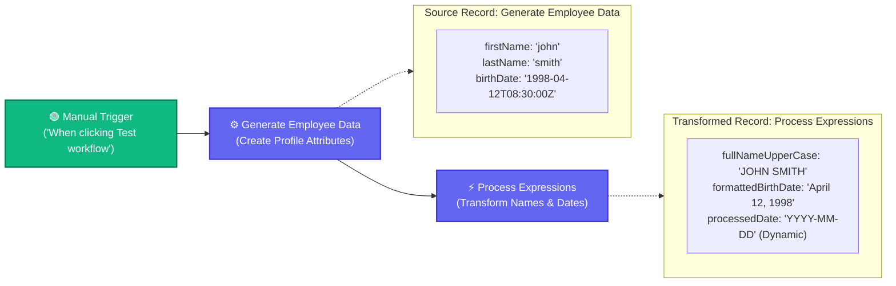

# Topic 5: Expressions & Variables

> **Institution:** Tayana Academy | LMS Assessment  
> **Topic:** N8N Hands-On Beginner | Topic 5: Expressions & Variables  
> **Workflow Name:** `Topic5_Expressions_Assessment`  
> **Target Audience:** Trainee / Employee  
> **Difficulty Level:** Beginner  
> **Platform Version:** n8n version 1.0.0 or higher  
> **Student:** Abhishek Nikam (`abhishek.n@tayanasolutions.com`)  
> **Repository:** [n8n-assessments](https://github.com/3OOM/n8n-assessments)  

---

## 1. Assessment Overview & Objectives

This practical assessment evaluates the learner's capability to build, execute, verify, and document an n8n workflow leveraging dynamic expressions and runtime variables. In an enterprise scenario processing HR employee records, this workflow ingests employee profile data, combines and converts names to uppercase, parses ISO-8601 timestamps using n8n's `$dateTime` helper, and generates dynamic processing timestamps via the global `$now` variable.

### Key Deliverables in this Package:
1. **`README.md`**: Comprehensive assessment documentation covering architecture, node configurations, expression mechanics, Luxon tokens, and LMS submission notes.
2. **`Topic5_Expressions_Assessment.json`**: Official exportable n8n workflow file ready to import into any n8n v1+ instance.
3. **`README.pdf`**: Print-ready, professionally styled PDF document generated directly from this documentation.

---

## 2. Workflow Architecture & Data Flow

The workflow processes HR records in a linear 3-node sequence from left to right:



---

## 3. Node Specifications & Detailed Configuration

### Node 1: Manual Trigger
- **Node Label:** `When clicking ‘Test workflow’`
- **Node Type:** `n8n-nodes-base.manualTrigger` (typeVersion: `1`)
- **Purpose:** Entry point for controlled execution and iterative testing on the canvas.

### Node 2: Generate Employee Data
- **Node Label:** `Generate Employee Data`
- **Node Type:** `n8n-nodes-base.set` (typeVersion: `3.4`)
- **Fields to Set:**
  | Field Name | Data Type | Value | Description |
  | :--- | :--- | :--- | :--- |
  | `firstName` | `String` | `john` | Employee first name |
  | `lastName` | `String` | `smith` | Employee last name |
  | `birthDate` | `String` | `1998-04-12T08:30:00Z` | Standard ISO-8601 UTC timestamp |

### Node 3: Process Expressions
- **Node Label:** `Process Expressions`
- **Node Type:** `n8n-nodes-base.set` (typeVersion: `3.4`)
- **Include Other Input Fields:** `false` (outputs a clean, dedicated transformed schema)
- **Fields to Set & Dynamic Expressions:**
  | Field Name | Data Type | Dynamic Expression Syntax | Evaluated Result |
  | :--- | :--- | :--- | :--- |
  | `fullNameUpperCase` | `String` | `={{ ($json.firstName + ' ' + $json.lastName).toUpperCase() }}` | `"JOHN SMITH"` |
  | `formattedBirthDate` | `String` | `={{ $dateTime.fromISO($json.birthDate).toFormat('MMMM dd, yyyy') }}` | `"April 12, 1998"` |
  | `processedDate` | `String` | `={{ $now.toFormat('yyyy-MM-dd') }}` | Current execution date (e.g. `"2026-10-12"`) |

---

## 4. Assessment Tasks & Step-by-Step Walkthrough

### Exercise 1 – Create and Save the Assessment Workflow
- Created a fresh blank workflow canvas.
- Renamed the workflow exactly to:
  ```text
  Topic5_Expressions_Assessment
  ```
- Positioned the `Manual Trigger` node and saved the workflow (`Ctrl+S` / `Cmd+S`).

### Exercise 2 – Generate the Employee Input Data
- Added an Edit Fields (Set) node renamed to **`Generate Employee Data`**.
- Configured three string attributes:
  - `firstName` = `john`
  - `lastName` = `smith`
  - `birthDate` = `1998-04-12T08:30:00Z`
- Tested the node to verify valid JSON output is available for downstream referencing.

### Exercise 3 – Build the Full Name Expression
- Added the second Edit Fields (Set) node renamed to **`Process Expressions`**.
- Configured field `fullNameUpperCase` as a String.
- Implemented the expression:
  ```javascript
  {{ ($json.firstName + ' ' + $json.lastName).toUpperCase() }}
  ```
- Evaluated result: `"john"` and `"smith"` are joined with a single space separator and transformed via `.toUpperCase()` to `"JOHN SMITH"`.

### Exercise 4 – Parse and Format the Birth Date
- In `Process Expressions`, added field `formattedBirthDate` as a String.
- Implemented the expression:
  ```javascript
  {{ $dateTime.fromISO($json.birthDate).toFormat('MMMM dd, yyyy') }}
  ```
- Evaluated result: Parses the ISO UTC timestamp into a Luxon DateTime object and formats it with tokens `MMMM dd, yyyy` to `"April 12, 1998"`.

### Exercise 5 – Generate the Current Processing Date
- In `Process Expressions`, added field `processedDate` as a String.
- Implemented the expression:
  ```javascript
  {{ $now.toFormat('yyyy-MM-dd') }}
  ```
- Evaluated result: Uses the n8n built-in global variable `$now` to extract the live runtime timestamp and formats it as `yyyy-MM-dd`.

### Exercise 6 – Execute and Validate the Final Output
- Executed the complete workflow via **Test workflow**.
- All nodes executed with green checkmarks (0 errors).
- Inspected the output in JSON view, verifying all three transformed fields.

### Exercise 7 – Export, Document, and Prepare Submission Evidence
- Exported the completed workflow as [`Topic5_Expressions_Assessment.json`](./Topic5_Expressions_Assessment.json).
- Generated publication PDF [`README.pdf`](./README.pdf).
- Updated centralized public repository index at `3OOM/n8n-assessments`.

---

## 5. Final Output Payload & Multi-View Inspection

### Final Verified JSON Output Payload
```json
[
  {
    "fullNameUpperCase": "JOHN SMITH",
    "formattedBirthDate": "April 12, 1998",
    "processedDate": "2026-10-12"
  }
]
```

### Multi-View Inspection Matrix

| View Mode | What Evaluator Observes | Verification Criteria Met |
| :--- | :--- | :--- |
| **Table View** | 3 columns: `fullNameUpperCase`, `formattedBirthDate`, `processedDate`. Single row displaying `JOHN SMITH \| April 12, 1998 \| 2026-10-12`. | Clean tabular presentation of all transformed expressions. |
| **JSON View** | Clean key-value JSON structure with exact property names and values matching assessment criteria. | Exact match: uppercase text, formatted Luxon date, and dynamic `$now` date. |
| **Schema View** | • `fullNameUpperCase`: `string`<br>• `formattedBirthDate`: `string`<br>• `processedDate`: `string` | Confirms strict type adherence across all 3 properties. |

---

## 6. Technical Concepts: Expressions, Date Helpers & Variables

### 1. String Concatenation & JavaScript Methods
- In n8n, expressions are delimited by double curly braces `{{ ... }}`.
- JavaScript string operations can be chained directly:
  `($json.firstName + ' ' + $json.lastName).toUpperCase()`
- Parentheses ensure concatenation evaluates first before invoking `.toUpperCase()`.

### 2. Built-in `$dateTime` Helper & Luxon Formatting
- n8n provides `$dateTime`, powered by the robust **Luxon** library.
- `$dateTime.fromISO(isoString)` correctly parses standard ISO-8601 strings (including timezone offsets `Z`).
- `.toFormat('MMMM dd, yyyy')` uses standard Luxon date tokens:
  - `MMMM`: Full month name (e.g. `April`)
  - `dd`: Two-digit day of the month (e.g. `12`)
  - `yyyy`: Four-digit calendar year (e.g. `1998`)

### 3. Global `$now` Runtime Variable
- `$now` is an n8n built-in global variable representing the exact timestamp at workflow execution.
- Calling `.toFormat('yyyy-MM-dd')` formats the execution date dynamically without manual updates.

---

## 7. Practical Assessment Checklist

- [x] Workflow created and named **`Topic5_Expressions_Assessment`**.
- [x] Manual Trigger configured as starting node.
- [x] `Generate Employee Data` node configured with `firstName`, `lastName`, and `birthDate`.
- [x] Employee input values and String data types verified.
- [x] `Process Expressions` node connected correctly.
- [x] Dynamic string concatenation implemented.
- [x] Uppercase conversion implemented with `.toUpperCase()`.
- [x] ISO birth date parsed using `$dateTime.fromISO()`.
- [x] Birth date formatted using `MMMM dd, yyyy` to `"April 12, 1998"`.
- [x] Current date generated dynamically using `$now`.
- [x] Current date formatted using `yyyy-MM-dd`.
- [x] Workflow executed successfully without errors.
- [x] Final JSON output validated across Table, JSON, and Schema views.
- [x] Workflow JSON exported (`Topic5_Expressions_Assessment.json`).
- [x] README documentation completed.
- [x] Formatted print PDF generated (`README.pdf`).
- [x] Pushed all deliverables to public GitHub repository.

---

## 8. LMS Submission Description & Assessor Notes

> **Copy and paste the text below directly into the LMS Description field when submitting:**

```text
================================================================================
TAYANA ACADEMY LMS SUBMISSION | TOPIC 5: EXPRESSIONS & VARIABLES
================================================================================
Student Name: Abhishek Nikam
Student Email: abhishek.n@tayanasolutions.com
Workflow Name: Topic5_Expressions_Assessment
GitHub Repository: https://github.com/3OOM/n8n-assessments/tree/main/topic-05-expressions-and-variables
Demo Video Link: [INSERT YOUR LOOM OR YOUTUBE LINK HERE]

1. WORKFLOW IMPLEMENTATION SUMMARY:
- Constructed a 3-node sequential pipeline: Manual Trigger -> Edit Fields (Generate Employee Data) -> Edit Fields (Process Expressions).
- "Generate Employee Data" creates standard employee profile attributes:
  * firstName (String): "john"
  * lastName (String): "smith"
  * birthDate (String): "1998-04-12T08:30:00Z"
- "Process Expressions" applies n8n inline expressions and built-in variables:
  * fullNameUpperCase (String): {{ ($json.firstName + ' ' + $json.lastName).toUpperCase() }} -> "JOHN SMITH"
  * formattedBirthDate (String): {{ $dateTime.fromISO($json.birthDate).toFormat('MMMM dd, yyyy') }} -> "April 12, 1998"
  * processedDate (String): {{ $now.toFormat('yyyy-MM-dd') }} -> dynamically generates current execution date
- Resulting output contains strictly the 3 transformed fields with clean native String types.

2. KEY TECHNICAL HIGHLIGHTS & EXPRESSIONS:
- String Methods & Concatenation: Combined firstName and lastName with single space separator and applied native JavaScript .toUpperCase().
- Luxon Date Parsing: Utilized built-in $dateTime.fromISO() to parse UTC ISO timestamp and formatted with 'MMMM dd, yyyy' tokens.
- Dynamic Execution Variable: Leveraged the global $now object with .toFormat('yyyy-MM-dd') to avoid hardcoding execution dates.

3. VERIFICATION ACROSS MULTI-VIEW MODES:
- Table View: Verified 3 clean columns rendering the transformed values.
- JSON View: Confirmed payload strictly matches the expected JSON structure.
- Schema View: Confirmed string primitive types across all properties.

4. ASSUMPTIONS & TIMEZONE CONSIDERATIONS:
- Assumes birthDate is provided in valid ISO-8601 format.
- $now evaluates in the instance's configured runtime timezone; formatting as 'yyyy-MM-dd' ensures clean date presentation.
================================================================================
```

---

## 9. Demo Video Recording Guide (60–90 Seconds)

| Timestamp | Screen Action | Voiceover Script |
| :--- | :--- | :--- |
| **0:00 – 0:15** | Show canvas with title `Topic5_Expressions_Assessment` and the 3 connected nodes: Manual Trigger ➔ Generate Employee Data ➔ Process Expressions. | *"Hello evaluator! In Topic 5, we are demonstrating expressions and variables in n8n. Here is our 3-node assessment workflow on the canvas."* |
| **0:15 – 0:35** | Open `Generate Employee Data` modal. Show `firstName: 'john'`, `lastName: 'smith'`, and `birthDate: '1998-04-12T08:30:00Z'`. | *"In 'Generate Employee Data', we establish our raw employee fields: firstName as 'john', lastName as 'smith', and an ISO timestamp for birthDate."* |
| **0:35 – 0:55** | Open `Process Expressions` modal. Highlight `fullNameUpperCase` with `.toUpperCase()`, `formattedBirthDate` with `$dateTime.fromISO()`, and `processedDate` with `$now`. | *"In 'Process Expressions', we combine names and convert to uppercase, parse the birth date using n8n's $dateTime helper with Luxon tokens, and extract the current date dynamically using $now."* |
| **0:55 – 1:15** | Click **Test workflow**. Open final output. Toggle Table, JSON, and Schema views. Point out all 3 transformed values. | *"Running Test workflow, both nodes execute with green checkmarks. In JSON view, we see 'JOHN SMITH', 'April 12, 1998', and our live execution date."* |
| **1:15 – 1:30** | Show GitHub repository and PDF documentation. Wrap up. | *"All deliverables, including the JSON workflow export and formatted PDF documentation, are published to our public GitHub repo. Thank you!"* |
