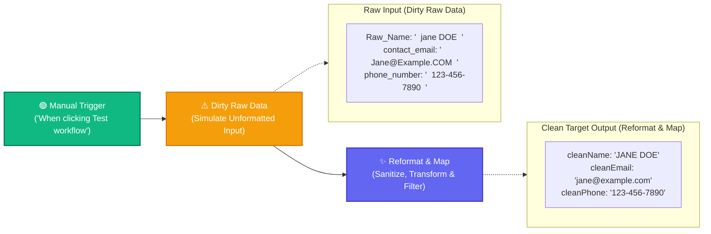

# Topic 6: Data Transformation

> **Institution:** Tayana Academy | LMS Assessment  
> **Topic:** N8N Hands-On Beginner | Topic 6: Data Transformation  
> **Workflow Name:** `Topic6_Data_Transformation_Assessment`  
> **Target Audience:** Trainee / Employee  
> **Difficulty Level:** Beginner  
> **Platform Version:** n8n version 1.0.0 or higher  
> **Student:** Abhishek Nikam (`abhishek.n@tayanasolutions.com`)  
> **Repository:** [n8n-assessments](https://github.com/3OOM/n8n-assessments)  

---

## 1. Assessment Overview & Objectives

This practical assessment evaluates the learner's ability to clean, transform, standardize, and map inconsistent customer data into a structured target schema using core n8n nodes and expressions. The workflow ingests raw, unformatted customer information containing irregular casing and unwanted whitespace, sanitizes each attribute using chained JavaScript string methods, excludes original source fields, and delivers a pristine, standardized output schema.

### Key Deliverables in this Package:
1. **`README.md`**: Comprehensive assessment documentation covering architecture, string transformation mechanics, schema pruning, and LMS submission notes.
2. **`Topic6_Data_Transformation_Assessment.json`**: Official exportable n8n workflow file ready to import into any n8n v1+ instance.
3. **`README.pdf`**: Print-ready, professionally styled PDF document generated directly from this documentation.

---

## 2. Workflow Architecture & Data Flow

The data transformation pipeline executes in a 3-node sequence from left to right:



---

## 3. Node Specifications & Detailed Configuration

### Node 1: Manual Trigger
- **Node Label:** `When clicking ‘Test workflow’`
- **Node Type:** `n8n-nodes-base.manualTrigger` (typeVersion: `1`)
- **Purpose:** Entry point for controlled execution and testing on the canvas.

### Node 2: Dirty Raw Data
- **Node Label:** `Dirty Raw Data`
- **Node Type:** `n8n-nodes-base.set` (typeVersion: `3.4`)
- **Fields to Set (Simulating Unsanitized CRM Data):**
  | Field Name | Data Type | Raw Assigned Value | Issues Present |
  | :--- | :--- | :--- | :--- |
  | `Raw_Name` | `String` | `"  jane DOE  "` | Leading/trailing spaces, mixed inconsistent casing |
  | `contact_email` | `String` | `"  Jane@Example.COM  "` | Leading/trailing spaces, uppercase characters in domain/username |
  | `phone_number` | `String` | `"  123-456-7890  "` | Leading and trailing whitespace padding |

### Node 3: Reformat & Map
- **Node Label:** `Reformat & Map`
- **Node Type:** `n8n-nodes-base.set` (typeVersion: `3.4`)
- **Include Other Input Fields:** `false` (Disabled to exclude all original dirty source attributes)
- **Target Transformed Fields & Chained Expressions:**
  | Clean Field Name | Data Type | Transformation Expression Syntax | Sanitized Result |
  | :--- | :--- | :--- | :--- |
  | `cleanName` | `String` | `={{ $json.Raw_Name.trim().toUpperCase() }}` | `"JANE DOE"` |
  | `cleanEmail` | `String` | `={{ $json.contact_email.trim().toLowerCase() }}` | `"jane@example.com"` |
  | `cleanPhone` | `String` | `={{ $json.phone_number.trim() }}` | `"123-456-7890"` |

---

## 4. Assessment Tasks & Step-by-Step Walkthrough

### Exercise 1 – Create and Save the Assessment Workflow
- Created a fresh blank workflow canvas.
- Renamed the workflow exactly to:
  ```text
  Topic6_Data_Transformation_Assessment
  ```
- Positioned the `Manual Trigger` node and saved the workflow (`Ctrl+S` / `Cmd+S`).

### Exercise 2 – Generate Dirty Raw Customer Data
- Added an Edit Fields (Set) node renamed to **`Dirty Raw Data`**.
- Configured three unformatted string fields:
  - `Raw_Name`: `"  jane DOE  "`
  - `contact_email`: `"  Jane@Example.COM  "`
  - `phone_number`: `"  123-456-7890  "`
- Tested the node using **Test step** and verified that the dirty payload is available for downstream transformation.

### Exercise 3 – Reformat, Rename, and Map the Fields
- Added the second Edit Fields (Set) node renamed to **`Reformat & Map`**.
- **Disabled Include Other Input Fields** (`includeOtherFields: false`) so that raw fields are dropped from the final output.
- Configured the three sanitized fields:
  - `cleanName`: `={{ $json.Raw_Name.trim().toUpperCase() }}` (trims whitespace and forces uppercase)
  - `cleanEmail`: `={{ $json.contact_email.trim().toLowerCase() }}` (trims whitespace and forces lowercase)
  - `cleanPhone`: `={{ $json.phone_number.trim() }}` (trims padding whitespace)

### Exercise 4 – Execute and Validate the Final Payload
- Executed the complete workflow via **Test workflow**.
- Both nodes succeeded with green checkmark indicators (0 errors).
- Inspected the output in JSON view, confirming:
  - Output contains strictly `cleanName`, `cleanEmail`, and `cleanPhone`.
  - Values match `"JANE DOE"`, `"jane@example.com"`, and `"123-456-7890"`.
  - No legacy raw fields (`Raw_Name`, `contact_email`, `phone_number`) are leaked into the output.

### Exercise 5 – Prepare Evidence and Submission Package
- Exported the completed workflow as [`Topic6_Data_Transformation_Assessment.json`](./Topic6_Data_Transformation_Assessment.json).
- Generated publication PDF [`README.pdf`](./README.pdf).
- Updated centralized public repository index at `3OOM/n8n-assessments`.

---

## 5. Final Output Payload & Multi-View Inspection

### Final Verified Clean JSON Output Payload
```json
[
  {
    "cleanName": "JANE DOE",
    "cleanEmail": "jane@example.com",
    "cleanPhone": "123-456-7890"
  }
]
```

### Multi-View Inspection Matrix

| View Mode | What Evaluator Observes | Verification Criteria Met |
| :--- | :--- | :--- |
| **Table View** | 3 columns: `cleanName`, `cleanEmail`, `cleanPhone`. Row shows `JANE DOE \| jane@example.com \| 123-456-7890`. | Clean tabular presentation without raw field residue. |
| **JSON View** | Clean key-value JSON structure with exact property names and standardized values. | Exact match: uppercase name, lowercase email, trimmed phone. |
| **Schema View** | • `cleanName`: `string`<br>• `cleanEmail`: `string`<br>• `cleanPhone`: `string` | Confirms strict preservation of String primitive types. |

---

## 6. Deep Dive: Chained String Methods & Schema Pruning

### 1. JavaScript Method Chaining (`.trim().toUpperCase()`)
- In JavaScript and n8n expressions, string methods can be chained sequentially:
  - `.trim()` executes first, stripping all leading and trailing whitespace characters.
  - `.toUpperCase()` executes on the trimmed result, ensuring consistent capitalization.
  - Similarly, `.trim().toLowerCase()` standardizes email addresses to RFC-compliant lowercase format.

### 2. Schema Pruning via `includeOtherFields: false`
- In n8n, the Edit Fields (Set) node defaults to or provides an option to include incoming fields.
- By disabling **Include Other Input Fields**, n8n behaves as a selective schema projection: only explicitly configured fields are emitted in the output, preventing dirty or sensitive source attributes from leaking downstream.

---

## 7. Practical Assessment Checklist

- [x] Workflow created and saved as **`Topic6_Data_Transformation_Assessment`**.
- [x] Manual Trigger node added as initial starting node.
- [x] `Dirty Raw Data` node configured with `Raw_Name`, `contact_email`, and `phone_number`.
- [x] Irregular casing and whitespace padding verified in raw input data.
- [x] `Reformat & Map` node configured and connected.
- [x] **Include Other Input Fields disabled** (`includeOtherFields: false`).
- [x] `cleanName` renamed, trimmed, and converted to uppercase via `{{ $json.Raw_Name.trim().toUpperCase() }}`.
- [x] `cleanEmail` renamed, trimmed, and converted to lowercase via `{{ $json.contact_email.trim().toLowerCase() }}`.
- [x] `cleanPhone` renamed and trimmed via `{{ $json.phone_number.trim() }}`.
- [x] Original raw fields successfully excluded from final payload.
- [x] Workflow executed without errors (all green execution indicators).
- [x] Final JSON output validated across Table, JSON, and Schema views.
- [x] Workflow JSON exported (`Topic6_Data_Transformation_Assessment.json`).
- [x] Formatted print PDF generated (`README.pdf`).
- [x] Pushed all deliverables to public GitHub repository.

---

## 8. LMS Submission Description & Assessor Notes

> **Copy and paste the text below directly into the LMS Description field when submitting:**

```text
================================================================================
TAYANA ACADEMY LMS SUBMISSION | TOPIC 6: DATA TRANSFORMATION
================================================================================
Student Name: Abhishek Nikam
Student Email: abhishek.n@tayanasolutions.com
Workflow Name: Topic6_Data_Transformation_Assessment
GitHub Repository: https://github.com/3OOM/n8n-assessments/tree/main/topic-06-data-transformation

1. WORKFLOW IMPLEMENTATION SUMMARY:
- Constructed a 3-node sequential pipeline: Manual Trigger -> Edit Fields (Dirty Raw Data) -> Edit Fields (Reformat & Map).
- "Dirty Raw Data" creates raw customer records containing inconsistent casing and whitespace padding:
  * Raw_Name (String): "  jane DOE  "
  * contact_email (String): "  Jane@Example.COM  "
  * phone_number (String): "  123-456-7890  "
- "Reformat & Map" sanitizes, renames, and maps attributes using chained JavaScript expressions:
  * cleanName (String): {{ $json.Raw_Name.trim().toUpperCase() }} -> "JANE DOE"
  * cleanEmail (String): {{ $json.contact_email.trim().toLowerCase() }} -> "jane@example.com"
  * cleanPhone (String): {{ $json.phone_number.trim() }} -> "123-456-7890"
- Disabled "Include Other Input Fields" to drop dirty raw fields, outputting strictly the 3 clean properties.

2. KEY TECHNICAL HIGHLIGHTS & EXPRESSIONS:
- Chained String Methods: Utilized .trim().toUpperCase() and .trim().toLowerCase() to handle both whitespace sanitation and case normalization in a single declarative expression.
- Selective Schema Projection: By unchecking "Include Other Input Fields", achieved strict schema governance, ensuring no unformatted or legacy attributes pass to downstream consumers.

3. VERIFICATION ACROSS MULTI-VIEW MODES:
- Table View: Verified 3 clean columns without residual raw fields.
- JSON View: Confirmed payload strictly matches the expected target schema.
- Schema View: Confirmed string primitive types across all properties.

4. ASSUMPTIONS & NOTES FOR ASSESSOR:
- Assumes incoming contact fields are non-null string primitives.
- In production workflows, null-safe optional chaining (e.g. $json.Raw_Name?.trim()?.toUpperCase() ?? '') would be applied for additional defensive handling.
================================================================================
```
