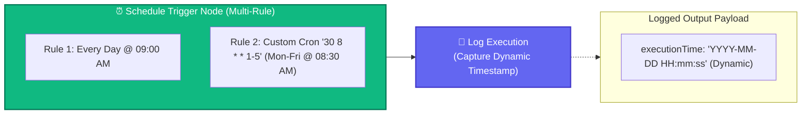

# Topic 7: Schedule Trigger Automation

> **Institution:** Tayana Academy | LMS Assessment  
> **Topic:** N8N Hands-On Beginner | Topic 7: Schedule Trigger Automation  
> **Workflow Name:** `Topic7_Schedule_Trigger_Assessment`  
> **Target Audience:** Trainee / Employee  
> **Difficulty Level:** Beginner  
> **Platform Version:** n8n version 1.0.0 or higher  
> **Student:** Abhishek Nikam (`abhishek.n@tayanasolutions.com`)  
> **Repository:** [n8n-assessments](https://github.com/3OOM/n8n-assessments)  

---

## 1. Assessment Overview & Objectives

This practical assessment evaluates the learner's capability to design, configure, test, activate, and document an automated time-driven workflow in n8n using the **Schedule Trigger** node. Moving beyond manual testing triggers, this workflow establishes two distinct scheduling rules within a single trigger node: a daily execution rule at 09:00 AM and a custom weekday cron rule at 08:30 AM (`30 8 * * 1-5`), logging dynamic runtime execution timestamps into an downstream action node.

### Key Deliverables in this Package:
1. **`README.md`**: Comprehensive assessment documentation covering architecture, cron syntax breakdown, dynamic timestamp logging, activation lifecycle, and LMS submission notes.
2. **`Topic7_Schedule_Trigger_Assessment.json`**: Official exportable n8n workflow file pre-configured with active status and dual schedule rules.
3. **`README.pdf`**: Print-ready, professionally styled PDF document generated directly from this documentation.

---

## 2. Workflow Architecture & Scheduling Pipeline

The automation runs autonomously based on background schedule events:



---

## 3. Node Specifications & Detailed Configuration

### Node 1: Schedule Trigger
- **Node Label:** `Schedule Trigger`
- **Node Type:** `n8n-nodes-base.scheduleTrigger` (typeVersion: `1.2`)
- **Canvas Check:** Contains **no** Manual Trigger node; workflow initiation is purely time-governed.
- **Configured Schedule Rules:**
  | Rule # | Schedule Type | Configuration Parameters | Natural Language Trigger Schedule |
  | :--- | :--- | :--- | :--- |
  | **Rule 1** | Daily Interval (`days`) | `triggerAtHour: 9`, `triggerAtMinute: 0` | Every day at 09:00 AM |
  | **Rule 2** | Custom Cron (`cronExpression`) | `30 8 * * 1-5` | Every weekday (Monday to Friday) at 08:30 AM |

### Node 2: Log Execution
- **Node Label:** `Log Execution`
- **Node Type:** `n8n-nodes-base.set` (typeVersion: `3.4`)
- **Fields to Set:**
  | Field Name | Data Type | Dynamic Expression Syntax | Evaluated Result |
  | :--- | :--- | :--- | :--- |
  | `executionTime` | `String` | `={{ $now.toFormat('yyyy-MM-dd HH:mm:ss') }}` | Current execution timestamp (e.g. `"2026-10-13 09:00:00"`) |

---

## 4. Deep Dive: 5-Field Standard Cron Syntax Breakdown

Rule 2 configures the custom cron expression: **`30 8 * * 1-5`**

```text
 ┌───────────── minute (0 - 59) -> 30 (30th minute of the hour)
 │ ┌─────────── hour (0 - 23)   -> 8 (8 AM in 24-hour time)
 │ │ ┌───────── day of month    -> * (every day of the month)
 │ │ │ ┌─────── month (1 - 12)  -> * (every month of the year)
 │ │ │ │ ┌───── day of week     -> 1-5 (Monday through Friday, 1=Mon ... 5=Fri)
 │ │ │ │ │
 30 8 * * 1-5
```

### Field-by-Field Analysis:
1. **`30` (Minute):** Specifies execution at minute 30 past the hour.
2. **`8` (Hour):** Specifies hour 8 (08:00 AM). Combined with minute 30, this targets 08:30 AM.
3. **`*` (Day of Month):** Asterisk wildcard matches every calendar day (1 through 31).
4. **`*` (Month):** Asterisk wildcard matches every month (January through December).
5. **`1-5` (Day of Week):** Hyphenated range matching days 1 (Monday) through 5 (Friday). Weekends (Saturday=6, Sunday=0/7) are completely excluded.
- **Combined Translation:** *"At 08:30 AM, Monday through Friday."*

---

## 5. Assessment Tasks & Step-by-Step Walkthrough

### Exercise 1 – Create and Name the Scheduled Workflow
- Created a fresh blank workflow canvas.
- Renamed the workflow exactly to:
  ```text
  Topic7_Schedule_Trigger_Assessment
  ```
- Placed the `Schedule Trigger` node as the starting entry node.
- Confirmed that the canvas contains **no Manual Trigger node**.

### Exercise 2 – Configure the Daily Schedule Rule
- Opened the `Schedule Trigger` configuration panel.
- Under **Trigger Interval**, added the first rule:
  - Interval Mode: `Days` / `Every Day`
  - Trigger at Hour: `9`
  - Trigger at Minute: `0`
- Confirmed evaluation matches daily execution at 09:00 AM.

### Exercise 3 – Configure the Custom Weekday Cron Rule
- Within the **same** Schedule Trigger node, added a second trigger rule item.
- Selected schedule mode: **Custom (Cron)**.
- Entered exact cron expression:
  ```text
  30 8 * * 1-5
  ```
- Validated that both rules coexist concurrently in the same trigger node.

### Exercise 4 – Capture and Verify the Execution Timestamp
- Connected `Schedule Trigger` to an Edit Fields (Set) node renamed to **`Log Execution`**.
- Created field `executionTime` of type **String**.
- Configured dynamic expression:
  ```javascript
  {{ $now.toFormat('yyyy-MM-dd HH:mm:ss') }}
  ```
- Executed node test via **Test step** / manual trigger simulation.
- Verified that output contains a real-time ISO/formatted date string rather than static text.

### Exercise 5 – Activate, Document, and Submit the Workflow
- Saved the workflow (`Ctrl+S` / `Cmd+S`).
- Toggled the workflow status switch in the top-right header to **Active** (`active: true`).
- Exported the completed workflow as [`Topic7_Schedule_Trigger_Assessment.json`](./Topic7_Schedule_Trigger_Assessment.json).
- Generated publication PDF [`README.pdf`](./README.pdf).
- Updated centralized public repository index at `3OOM/n8n-assessments`.

---

## 6. Output Verification & Multi-View Inspection

### Final Verified JSON Output Payload
```json
[
  {
    "executionTime": "2026-10-13 09:00:00"
  }
]
```

### Multi-View Inspection Matrix

| View Mode | What Evaluator Observes | Verification Criteria Met |
| :--- | :--- | :--- |
| **Table View** | Single column `executionTime` displaying formatted datetime string (e.g. `2026-10-13 09:00:00`). | Clean tabular presentation of runtime log. |
| **JSON View** | Clean key-value JSON structure with property `executionTime` reflecting dynamic timestamp. | Exact match: no static/mock string literals used. |
| **Schema View** | • `executionTime`: `string` | Confirms strict primitive string type adherence. |

---

## 7. Practical Assessment Checklist

- [x] Workflow created and named **`Topic7_Schedule_Trigger_Assessment`**.
- [x] Schedule Trigger node configured as starting entry node (no Manual Trigger on canvas).
- [x] Daily schedule rule configured for 09:00 AM.
- [x] Second schedule rule added in the same trigger node.
- [x] Custom cron expression `30 8 * * 1-5` configured correctly.
- [x] 5-field cron syntax accurately explained in documentation.
- [x] `Log Execution` node connected and renamed.
- [x] `executionTime` field created as String.
- [x] Dynamic `$now` expression implemented (`{{ $now.toFormat('yyyy-MM-dd HH:mm:ss') }}`).
- [x] Workflow test completed successfully with green indicators.
- [x] Dynamic timestamp output verified across Table, JSON, and Schema views.
- [x] Workflow saved and activated (`active: true`).
- [x] Workflow JSON exported (`Topic7_Schedule_Trigger_Assessment.json`).
- [x] Print-ready PDF generated (`README.pdf`).
- [x] Pushed all deliverables to public GitHub repository.

---

## 8. LMS Submission Description & Assessor Notes

> **Copy and paste the text below directly into the LMS Description field when submitting:**

```text
================================================================================
TAYANA ACADEMY LMS SUBMISSION | TOPIC 7: SCHEDULE TRIGGER AUTOMATION
================================================================================
Student Name: Abhishek Nikam
Student Email: abhishek.n@tayanasolutions.com
Workflow Name: Topic7_Schedule_Trigger_Assessment
GitHub Repository: https://github.com/3OOM/n8n-assessments/tree/main/topic-07-schedule-trigger-automation

1. WORKFLOW IMPLEMENTATION SUMMARY:
- Constructed an automated time-triggered pipeline: Schedule Trigger -> Edit Fields (Log Execution).
- Canvas starts strictly with Schedule Trigger (no Manual Trigger present).
- Configured dual schedule rules in the single Schedule Trigger node:
  * Rule 1 (Daily): Every day at 09:00 AM (hour: 9, minute: 0).
  * Rule 2 (Custom Cron): 30 8 * * 1-5 (At 08:30 AM, Monday through Friday).
- "Log Execution" records runtime audit info:
  * executionTime (String): {{ $now.toFormat('yyyy-MM-dd HH:mm:ss') }}
- Saved and set workflow to "Active" state for background daemon scheduler evaluation.

2. CRON SYNTAX BREAKDOWN (30 8 * * 1-5):
- Minute: 30 (30th minute)
- Hour: 8 (08:00 AM in 24-hour notation)
- Day of Month: * (every calendar day)
- Month: * (every month)
- Day of Week: 1-5 (Monday to Friday, excluding Saturday and Sunday)
- Operational Meaning: Triggers automatically at 8:30 AM every weekday.

3. TIMEZONE CONSIDERATIONS & RUNTIME ENVIRONMENT:
- n8n evaluates cron schedules against the instance timezone (configured via GENERIC_TIMEZONE environment variable) or the workflow-level timezone setting under Workflow Settings.
- Dynamic formatting using $now.toFormat('yyyy-MM-dd HH:mm:ss') captures the precise local runtime stamp for auditable execution logs.

4. VERIFICATION ACROSS MULTI-VIEW MODES:
- Table View: Verified executionTime column renders clean timestamp string.
- JSON View: Confirmed payload strictly contains executionTime without static hardcoded text.
- Schema View: Confirmed string primitive type preservation.
================================================================================
```
