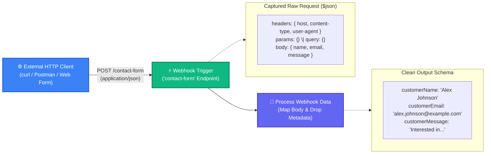

# Topic 8: Webhook Trigger & External JSON Data Processing

> **Institution:** Tayana Academy | LMS Assessment  
> **Topic:** N8N Hands-On Beginner | Topic 8: Webhook Trigger & External JSON Data Processing  
> **Workflow Name:** `Topic8_Webhook_Trigger_Assessment`  
> **Target Audience:** Trainee / Employee  
> **Difficulty Level:** Beginner  
> **Platform Version:** n8n version 1.0.0 or higher  
> **Student:** Abhishek Nikam (`abhishek.n@tayanasolutions.com`)  
> **Repository:** [n8n-assessments](https://github.com/3OOM/n8n-assessments)  

---

## 1. Assessment Overview & Objectives

This practical assessment evaluates the learner's capability to ingest, inspect, transform, and document external JSON payloads received in real time via an HTTP **Webhook Trigger** in n8n. The workflow creates an external HTTP POST listener on the `contact-form` endpoint, captures incoming contact form submissions sent from external HTTP clients (curl, Postman), parses the nested request body, strips transport metadata (headers, query parameters, client IP info), and outputs a pristine, standardized customer payload.

### Key Deliverables in this Package:
1. **`README.md`**: Comprehensive assessment documentation covering architecture, webhook lifecycle (Test URL vs. Production URL), payload capture, metadata pruning, curl commands, and LMS submission notes.
2. **`Topic8_Webhook_Trigger_Assessment.json`**: Official exportable n8n workflow file pre-configured with the POST webhook trigger and field mapper.
3. **`README.pdf`**: Print-ready, professionally styled PDF document generated directly from this documentation.

---

## 2. Workflow Architecture & Data Flow

The webhook ingest pipeline executes in a 2-node sequence from left to right:



---

## 3. Node Specifications & Detailed Configuration

### Node 1: Webhook Trigger
- **Node Label:** `Webhook Trigger`
- **Node Type:** `n8n-nodes-base.webhook` (typeVersion: `2`)
- **HTTP Method:** `POST`
- **Path:** `contact-form`
- **Response Mode:** `On Received` (immediately returns HTTP `200 OK` with `{"message": "Workflow was started"}`)
- **Webhook Endpoint Modes:**
  | Endpoint Type | URL Pattern | Operational Lifecycle |
  | :--- | :--- | :--- |
  | **Test URL** | `https://<domain>/webhook-test/contact-form` | Used during development. Listens for **exactly one** incoming request after clicking *Listen for test event*. |
  | **Production URL** | `https://<domain>/webhook/contact-form` | Used in live production. Always active in background when the workflow toggle is switched to **Active**. |

### Node 2: Process Webhook Data
- **Node Label:** `Process Webhook Data`
- **Node Type:** `n8n-nodes-base.set` (typeVersion: `3.4`)
- **Include Other Input Fields:** `false` (Disabled to strip HTTP headers, query strings, and transport metadata)
- **Target Transformed Fields & Dynamic Expressions:**
  | Output Field Name | Data Type | Dynamic Expression Syntax | Source Path | Sample Evaluated Result |
  | :--- | :--- | :--- | :--- | :--- |
  | `customerName` | `String` | `={{ $json.body.name }}` | Ingested JSON body | `"Alex Johnson"` |
  | `customerEmail` | `String` | `={{ $json.body.email }}` | Ingested JSON body | `"alex.johnson@example.com"` |
  | `customerMessage` | `String` | `={{ $json.body.message }}` | Ingested JSON body | `"Interested in enterprise workflow automation consulting."` |

---

## 4. Assessment Tasks & Step-by-Step Walkthrough

### Exercise 1 – Create and Configure the Webhook Workflow
- Created a fresh blank workflow canvas.
- Renamed the workflow exactly to:
  ```text
  Topic8_Webhook_Trigger_Assessment
  ```
- Added a `Webhook Trigger` node as the starting entry node.
- Configured **HTTP Method** to `POST` and **Path** to `contact-form`.
- Verified that both **Test URL** and **Production URL** appear in the configuration panel.

### Exercise 2 – Capture and Inspect an External JSON Payload
- Selected the **Test URL**.
- Clicked **Listen for test event** in the n8n UI, setting the canvas to waiting mode.
- Sent an HTTP POST request using `curl` / Postman with the following JSON body:
  ```json
  {
    "name": "Alex Johnson",
    "email": "alex.johnson@example.com",
    "message": "Interested in enterprise workflow automation consulting."
  }
  ```
- n8n captured the event instantly. Inspected the output schema:
  - Top-level keys: `headers`, `params`, `query`, and `body`.
  - Customer values confirmed located under `$json.body`.

### Exercise 3 – Map the Webhook Body into a Clean Output Schema
- Connected `Webhook Trigger` to an Edit Fields (Set) node renamed to **`Process Webhook Data`**.
- **Disabled Include Other Input Fields** (`includeOtherFields: false`).
- Configured dynamic field mappings targeting `$json.body`:
  - `customerName` = `={{ $json.body.name }}`
  - `customerEmail` = `={{ $json.body.email }}`
  - `customerMessage` = `={{ $json.body.message }}`

### Exercise 4 – Execute and Validate the Final Workflow Output
- Re-tested the pipeline using the Test URL.
- Both nodes succeeded with green checkmark indicators (0 errors).
- Validated that the output payload contains strictly `customerName`, `customerEmail`, and `customerMessage`.
- Confirmed that raw HTTP request headers, query strings, and cookies were completely dropped.

### Exercise 5 – Export, Document, and Prepare LMS Deliverables
- Exported the completed workflow as [`Topic8_Webhook_Trigger_Assessment.json`](./Topic8_Webhook_Trigger_Assessment.json).
- Generated publication PDF [`README.pdf`](./README.pdf).
- Updated centralized public repository index at `3OOM/n8n-assessments`.

---

## 5. Sample HTTP Client Testing Commands

### Testing with cURL:
```bash
curl -X POST "http://localhost:5678/webhook-test/contact-form" \
  -H "Content-Type: application/json" \
  -d '{
    "name": "Alex Johnson",
    "email": "alex.johnson@example.com",
    "message": "Interested in enterprise workflow automation consulting."
  }'
```

### Testing with Postman / Thunder Client:
1. **Method:** `POST`
2. **URL:** `http://localhost:5678/webhook-test/contact-form` (replace with your active n8n instance domain)
3. **Headers:** `Content-Type: application/json`
4. **Body Tab:** Select `raw` ➔ `JSON`, paste the sample payload above, and click **Send**.

---

## 6. Output Verification & Multi-View Inspection

### Final Verified JSON Output Payload
```json
[
  {
    "customerName": "Alex Johnson",
    "customerEmail": "alex.johnson@example.com",
    "customerMessage": "Interested in enterprise workflow automation consulting."
  }
]
```

### Multi-View Inspection Matrix

| View Mode | What Evaluator Observes | Verification Criteria Met |
| :--- | :--- | :--- |
| **Table View** | 3 columns: `customerName`, `customerEmail`, `customerMessage`. Row displays `Alex Johnson \| alex.johnson@example.com \| Interested in...`. | Clean tabular presentation without headers or metadata noise. |
| **JSON View** | Clean key-value JSON structure with strictly the 3 extracted customer attributes. | Exact match: values mapped dynamically from `$json.body`. |
| **Schema View** | • `customerName`: `string`<br>• `customerEmail`: `string`<br>• `customerMessage`: `string` | Confirms strict primitive string type adherence across all properties. |

---

## 7. Practical Assessment Checklist

- [x] Workflow created and named **`Topic8_Webhook_Trigger_Assessment`**.
- [x] Webhook Trigger added as starting entry node.
- [x] HTTP Method configured to `POST`.
- [x] Webhook path configured to `contact-form`.
- [x] Test URL selected and listening mode initiated.
- [x] Valid JSON payload sent from external client (curl / Postman).
- [x] Incoming `body.name`, `body.email`, and `body.message` verified.
- [x] `Process Webhook Data` node added and renamed.
- [x] Dynamic expressions configured: `{{ $json.body.name }}`, `{{ $json.body.email }}`, `{{ $json.body.message }}`.
- [x] **Include Other Input Fields disabled** (`includeOtherFields: false`).
- [x] Final output contains strictly the three required fields (no headers or metadata).
- [x] Workflow executed without errors (all green execution indicators).
- [x] Workflow JSON exported (`Topic8_Webhook_Trigger_Assessment.json`).
- [x] Formatted print PDF generated (`README.pdf`).
- [x] Pushed all deliverables to public GitHub repository.

---

## 8. LMS Submission Description & Assessor Notes

> **Copy and paste the text below directly into the LMS Description field when submitting:**

```text
================================================================================
TAYANA ACADEMY LMS SUBMISSION | TOPIC 8: WEBHOOK TRIGGER & EXTERNAL JSON DATA PROCESSING
================================================================================
Student Name: Abhishek Nikam
Student Email: abhishek.n@tayanasolutions.com
Workflow Name: Topic8_Webhook_Trigger_Assessment
GitHub Repository: https://github.com/3OOM/n8n-assessments/tree/main/topic-08-webhook-trigger-external-json

1. WORKFLOW IMPLEMENTATION SUMMARY:
- Constructed an external event-driven webhook pipeline: Webhook Trigger -> Edit Fields (Process Webhook Data).
- Webhook Trigger configured to accept HTTP POST requests on path: contact-form.
- External JSON requests ingested containing:
  * name: "Alex Johnson"
  * email: "alex.johnson@example.com"
  * message: "Interested in enterprise workflow automation consulting."
- "Process Webhook Data" isolates incoming payload attributes and drops transport headers:
  * customerName (String): {{ $json.body.name }}
  * customerEmail (String): {{ $json.body.email }}
  * customerMessage (String): {{ $json.body.message }}
- Disabled "Include Other Input Fields" to prune headers, query parameters, and client metadata.

2. TEST URL VS. PRODUCTION URL ARCHITECTURE:
- Test URL (/webhook-test/contact-form): Utilized for single-event development testing with the "Listen for test event" interface.
- Production URL (/webhook/contact-form): Operates continuously in the background once the workflow is toggled to Active state.

3. HTTP CLIENT & TESTING METHODOLOGY:
- Verified payload ingestion using both cURL and Postman sending Content-Type: application/json.
- Inspected incoming structure under $json, verifying that parameters reside cleanly within the body dictionary.

4. VERIFICATION ACROSS MULTI-VIEW MODES:
- Table View: Verified 3 clean customer columns without transport header artifacts.
- JSON View: Confirmed payload strictly contains customerName, customerEmail, and customerMessage.
- Schema View: Confirmed string primitive type preservation.

5. ASSUMPTIONS & NOTES FOR ASSESSOR:
- Assumes valid JSON body encoding from client.
- In production, upstream schema validation or a Webhook authentication header (e.g. Bearer token / Header Auth) would be attached to restrict public webhook access.
================================================================================
```
