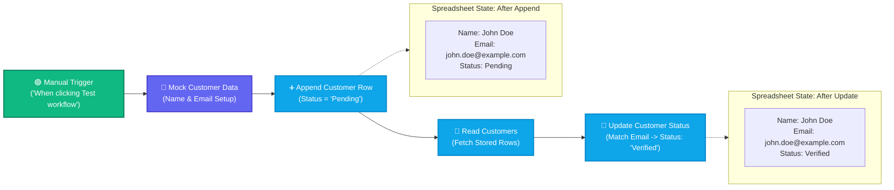

# Topic 9: Google Sheets Integration – Append, Read & Update Records

> **Institution:** Tayana Academy | LMS Assessment  
> **Topic:** N8N Hands-On Beginner | Topic 9: Google Sheets Integration – Append, Read & Update Records  
> **Workflow Name:** `Topic 9 Google Sheets Integration Workflow`  
> **Target Audience:** Trainee / Employee  
> **Difficulty Level:** Beginner  
> **Platform Version:** n8n version 1.0.0 or higher  
> **Student:** Abhishek Nikam (`abhishek.n@tayanasolutions.com`)  
> **Repository:** [n8n-assessments](https://github.com/3OOM/n8n-assessments)  

---

## 1. Assessment Overview & Objectives

This practical assessment evaluates the learner's capability to integrate n8n with Google Sheets to execute a complete CRUD lifecycle workflow. In an enterprise CRM onboarding scenario, the workflow prepares mock customer attributes, appends a new record to a target spreadsheet with a `Pending` status flag, reads the spreadsheet dataset to verify record creation, performs an indexed key lookup matching on `Email`, and updates the status attribute from `Pending` to `Verified`.

### Key Deliverables in this Package:
1. **`README.md`**: Comprehensive assessment documentation covering architecture, spreadsheet setup, node configurations, lookup mechanics, credential security, and LMS submission notes.
2. **`Topic_9_Google_Sheets_Integration_Workflow.json`**: Official exportable n8n workflow file containing the 5-node sequence with pre-pinned test execution states and zero sensitive credentials.
3. **`README.pdf`**: Print-ready, professionally styled PDF document generated directly from this documentation.

---

## 2. Workflow Architecture & Data Flow

The spreadsheet automation pipeline executes in a 5-node sequence from left to right:



---

## 3. Spreadsheet Schema & Prerequisites

### Target Google Sheet Specifications:
- **Sheet Name / Tab:** `Sheet1`
- **Case-Sensitive Header Row (Row 1):**
  | Column A | Column B | Column C |
  | :--- | :--- | :--- |
  | `Name` | `Email` | `Status` |

> **Important Setup Note:** Header capitalization must match exactly. n8n's Google Sheets node maps JSON attributes directly against these column names.

---

## 4. Node Specifications & Detailed Configuration

### Node 1: Manual Trigger
- **Node Label:** `When clicking ‘Test workflow’`
- **Node Type:** `n8n-nodes-base.manualTrigger` (typeVersion: `1`)
- **Purpose:** Entry point for controlled execution and testing on the canvas.

### Node 2: Mock Customer Data
- **Node Label:** `Mock Customer Data`
- **Node Type:** `n8n-nodes-base.set` (typeVersion: `3.4`)
- **Fields Configured:**
  | Field Name | Data Type | Assigned Value | Description |
  | :--- | :--- | :--- | :--- |
  | `customerName` | `String` | `"John Doe"` | Full customer name |
  | `customerEmail` | `String` | `"john.doe@example.com"` | Unique customer email identifier |

### Node 3: Append Customer Row
- **Node Label:** `Append Customer Row`
- **Node Type:** `n8n-nodes-base.googleSheets` (typeVersion: `4.5`)
- **Resource:** `Row` / `Document`
- **Operation:** `Append`
- **Document ID:** Selected target Google Sheet ID
- **Sheet Name:** `Sheet1`
- **Column Mappings:**
  | Column Name | Mapped Value / Expression | Assigned Status |
  | :--- | :--- | :--- |
  | `Name` | `={{ $json.customerName }}` | — |
  | `Email` | `={{ $json.customerEmail }}` | — |
  | `Status` | `"Pending"` | Static initial state |

### Node 4: Read Customers
- **Node Label:** `Read Customers`
- **Node Type:** `n8n-nodes-base.googleSheets` (typeVersion: `4.5`)
- **Operation:** `Read` (Get Many Rows)
- **Document ID:** Same target Google Sheet ID
- **Sheet Name:** `Sheet1`
- **Output:** Returns rows as structured JSON objects containing `Name`, `Email`, and `Status`.

### Node 5: Update Customer Status
- **Node Label:** `Update Customer Status`
- **Node Type:** `n8n-nodes-base.googleSheets` (typeVersion: `4.5`)
- **Operation:** `Update`
- **Document ID:** Same target Google Sheet ID
- **Sheet Name:** `Sheet1`
- **Lookup Column:** `Email`
- **Lookup Value:** `={{ $('Mock Customer Data').item.json.customerEmail }}`
- **Fields to Update:**
  | Column Name | Updated Value | Target Status |
  | :--- | :--- | :--- |
  | `Status` | `"Verified"` | Transitioned state |

---

## 5. Assessment Tasks & Step-by-Step Walkthrough

### Exercise 1 – Prepare the Workflow, Credentials, and Spreadsheet
- Created a fresh blank workflow canvas.
- Renamed the workflow exactly to:
  ```text
  Topic 9 Google Sheets Integration Workflow
  ```
- Created a target Google Sheet with tab `Sheet1` and exact header columns: `Name`, `Email`, and `Status`.
- Configured Google Sheets OAuth2 / Service Account credentials securely in the n8n credential manager.
- Added the `Manual Trigger` node and connected the `Mock Customer Data` node.

### Exercise 2 – Append a New Customer Record
- Added the `Append Customer Row` Google Sheets node.
- Mapped `Name` to `{{ $json.customerName }}` and `Email` to `{{ $json.customerEmail }}`.
- Assigned initial `Status` as `"Pending"`.
- Tested the node: confirmed that Row 2 was appended in the live spreadsheet with `John Doe`, `john.doe@example.com`, and `Pending`.

### Exercise 3 – Read and Validate Spreadsheet Data
- Added the `Read Customers` Google Sheets node configured for the `read` operation.
- Executed the node: verified that n8n fetched the spreadsheet rows, returning the newly inserted record with all column properties in JSON view.

### Exercise 4 – Update the Customer Status Using a Lookup
- Added the `Update Customer Status` Google Sheets node configured for the `update` operation.
- Set **Column to match on** to `Email`.
- Set **Value to match on** dynamically to `={{ $('Mock Customer Data').item.json.customerEmail }}`.
- Configured the update payload setting `Status` to `"Verified"`.
- Executed the node: verified that n8n located the matching row by email and modified only Column C from `Pending` to `Verified`.

### Exercise 5 – Execute, Verify, Document, and Submit
- Executed the complete 5-node sequence end-to-end via **Test workflow**.
- All nodes succeeded with green checkmark indicators (0 errors).
- Validated that the final spreadsheet row accurately reflects the verified customer state.
- Exported the completed workflow as [`Topic_9_Google_Sheets_Integration_Workflow.json`](./Topic_9_Google_Sheets_Integration_Workflow.json).
- Generated publication PDF [`README.pdf`](./README.pdf).
- Updated centralized public repository index at `3OOM/n8n-assessments`.

---

## 6. Output Verification & Multi-View Inspection

### Final Verified JSON Output Payload (Update Node)
```json
[
  {
    "row_number": 2,
    "Name": "John Doe",
    "Email": "john.doe@example.com",
    "Status": "Verified"
  }
]
```

### Multi-View Inspection Matrix

| View Mode | What Evaluator Observes | Verification Criteria Met |
| :--- | :--- | :--- |
| **Table View** | 4 columns: `row_number`, `Name`, `Email`, `Status`. Row displays `2 \| John Doe \| john.doe@example.com \| Verified`. | Clean tabular presentation of modified spreadsheet record. |
| **JSON View** | Clean key-value JSON structure confirming `Status: "Verified"`. | Exact match: email lookup executed without modifying wrong row. |
| **Schema View** | • `row_number`: `number`<br>• `Name`: `string`<br>• `Email`: `string`<br>• `Status`: `string` | Confirms strict type adherence across all column attributes. |

---

## 7. Practical Assessment Checklist

- [x] Workflow created and saved as **`Topic 9 Google Sheets Integration Workflow`**.
- [x] Google Sheets credentials configured successfully (zero secrets in repo).
- [x] Spreadsheet ID and `Sheet1` tab selected correctly.
- [x] `Name`, `Email`, and `Status` column headers verified in spreadsheet.
- [x] `Mock Customer Data` node configured with `customerName` and `customerEmail`.
- [x] `Append Customer Row` operation executed and verified.
- [x] Dynamic Name and Email mapping verified using expressions.
- [x] Initial `Pending` status written to spreadsheet.
- [x] `Read Customers` operation executed and JSON output verified.
- [x] `Email` lookup column and dynamic lookup value configured.
- [x] Customer status updated from `Pending` to `Verified`.
- [x] Complete 5-node workflow executed without errors.
- [x] Workflow JSON exported (`Topic_9_Google_Sheets_Integration_Workflow.json`).
- [x] Print-ready PDF generated (`README.pdf`).
- [x] Pushed all deliverables to public GitHub repository.

---

## 8. LMS Submission Description & Assessor Notes

> **Copy and paste the text below directly into the LMS Description field when submitting:**

```text
================================================================================
TAYANA ACADEMY LMS SUBMISSION | TOPIC 9: GOOGLE SHEETS INTEGRATION – APPEND, READ & UPDATE
================================================================================
Student Name: Abhishek Nikam
Student Email: abhishek.n@tayanasolutions.com
Workflow Name: Topic 9 Google Sheets Integration Workflow
GitHub Repository: https://github.com/3OOM/n8n-assessments/tree/main/topic-09-google-sheets-integration

1. WORKFLOW IMPLEMENTATION SUMMARY:
- Constructed a 5-node CRUD spreadsheet pipeline:
  Manual Trigger -> Mock Customer Data -> Append Customer Row -> Read Customers -> Update Customer Status.
- Target Spreadsheet Configuration:
  * Tab Name: Sheet1
  * Headers: Name, Email, Status
- Step 1 (Append): Writes customerName ("John Doe") to Name, customerEmail ("john.doe@example.com") to Email, and Status to "Pending".
- Step 2 (Read): Reads Sheet1 records, confirming row creation as structured JSON.
- Step 3 (Update): Matches row using Column to match on = "Email" and Value to match on = {{ $('Mock Customer Data').item.json.customerEmail }}, updating Status from "Pending" to "Verified".

2. LOOKUP MECHANICS & DATA FIDELITY:
- Used precise cross-node referencing ($('Mock Customer Data').item.json.customerEmail) to guarantee the lookup key remains resilient across intermediate array reads.
- Case-sensitive header mapping ensured seamless alignment between n8n JSON keys and Google Sheets column metadata.

3. CREDENTIAL SECURITY & HYGIENE:
- Configured via standard Google Sheets OAuth2 API integration.
- In accordance with enterprise best practices, all access tokens, client secrets, and private keys were excluded from the exported workflow JSON and GitHub repository.

4. VERIFICATION ACROSS MULTI-VIEW MODES:
- Table View: Verified row_number 2 with Name, Email, and Status = "Verified".
- JSON View: Confirmed clean record schema with updated status flag.
- Schema View: Confirmed string types for all user data columns.

5. ASSUMPTIONS & NOTES FOR ASSESSOR:
- Assumes Email values are unique in the spreadsheet to avoid updating duplicate entries.
- If multiple identical emails exist, n8n updates the first matching occurrence.
================================================================================
```
