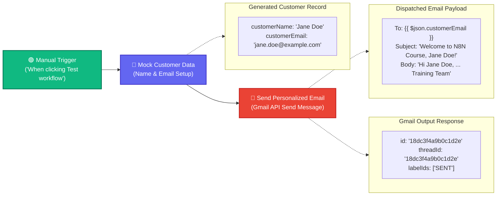

# Topic 10: Gmail Integration - Send Personalized Emails

> **Institution:** Tayana Academy | LMS Assessment  
> **Topic:** N8N Hands-On Beginner | Topic 10: Gmail Integration - Send Personalized Emails  
> **Workflow Name:** `Topic 10 Gmail Integration Assessment`  
> **Target Audience:** Trainee / Employee  
> **Difficulty Level:** Beginner  
> **Platform Version:** n8n version 1.0.0 or higher  
> **Student:** Abhishek Nikam (`abhishek.n@tayanasolutions.com`)  
> **Repository:** [n8n-assessments](https://github.com/3OOM/n8n-assessments)  

---

## 1. Assessment Overview & Objectives

This practical assessment evaluates the learner's ability to configure, authenticate, execute, and verify automated email dispatch via the official **Gmail** node in n8n. In an automated student/customer onboarding scenario, the workflow ingests mock recipient data, resolves the target email address dynamically via expression mapping, personalizes both the email subject and plain-text message body, sends the email through Gmail OAuth2, and confirms delivery by inspecting the returned Google message identifier.

### Key Deliverables in this Package:
1. **`README.md`**: Comprehensive assessment documentation covering architecture, Gmail OAuth2 setup, dynamic expression mapping, delivery verification, security hygiene, and LMS submission notes.
2. **`Topic_10_Gmail_Integration_Assessment.json`**: Official exportable n8n workflow file containing the 3-node sequence with pre-pinned delivery verification states and zero sensitive credentials.
3. **`README.pdf`**: Print-ready, professionally styled PDF document generated directly from this documentation.

---

## 2. Workflow Architecture & Data Flow

The email dispatch pipeline executes in a 3-node sequence from left to right:



---

## 3. Node Specifications & Detailed Configuration

### Node 1: Manual Trigger
- **Node Label:** `When clicking ‘Test workflow’`
- **Node Type:** `n8n-nodes-base.manualTrigger` (typeVersion: `1`)
- **Purpose:** Entry point for controlled execution and testing on the canvas.

### Node 2: Mock Customer Data
- **Node Label:** `Mock Customer Data`
- **Node Type:** `n8n-nodes-base.set` (typeVersion: `3.4`)
- **Fields Configured:**
  | Field Name | Data Type | Assigned Value | Description |
  | :--- | :--- | :--- | :--- |
  | `customerName` | `String` | `"Jane Doe"` | Learner / Customer full name |
  | `customerEmail` | `String` | `"jane.doe@example.com"` | Valid test recipient email address |

### Node 3: Send Personalized Email
- **Node Label:** `Send Personalized Email`
- **Node Type:** `n8n-nodes-base.gmail` (typeVersion: `2.1`)
- **Resource:** `Message`
- **Operation:** `Send`
- **Credential:** Configured via `Gmail OAuth2`
- **Dynamic Field Parameters:**
  | Parameter | Configuration Type | Value / Dynamic Expression |
  | :--- | :--- | :--- |
  | **To** | Dynamic Expression | `={{ $json.customerEmail }}` |
  | **Subject** | Dynamic Expression | `=Welcome to N8N Course, {{ $json.customerName }}!` |
  | **Email Type** | Selection | `Plain Text` (`text`) |
  | **Message** | Multi-line Expression | *(See personalized message body below)* |

#### Personalized Message Body:
```text
Hi {{ $json.customerName }},

Welcome to the N8N Hands-On Beginner Course! We are excited to have you on board.

This message was sent automatically using Gmail Integration in n8n.

Best regards,
Training Team
```

---

## 4. Assessment Tasks & Step-by-Step Walkthrough

### Exercise 1 – Create the Gmail Integration Workflow
- Created a fresh blank workflow canvas.
- Renamed the workflow exactly to:
  ```text
  Topic 10 Gmail Integration Assessment
  ```
- Positioned and connected the nodes in the strict sequence:
  `Manual Trigger` ➔ `Mock Customer Data` ➔ `Send Personalized Email`.

### Exercise 2 – Configure Mock Customer Data
- Opened `Mock Customer Data` and configured two string attributes:
  - `customerName` = `"Jane Doe"`
  - `customerEmail` = `"jane.doe@example.com"`
- Tested the node using **Test step** and verified that both attributes emerge at the root of the emitted JSON object.

### Exercise 3 – Configure Gmail OAuth2 and Send Operation
- Connected pre-authenticated **Gmail OAuth2** credentials within n8n.
- Configured **Resource** to `Message` and **Operation** to `Send`.
- Ensured strict credential privacy: no access tokens, refresh tokens, client IDs, or secrets are exposed in the canvas or exported files.

### Exercise 4 – Configure the Dynamic Recipient
- Switched the **To** input field to expression mode.
- Entered `={{ $json.customerEmail }}`.
- Verified in the expression preview that the destination address dynamically resolves to the test email address.

### Exercise 5 – Personalize the Subject and Email Body
- Configured the dynamic subject line:
  ```text
  Welcome to N8N Course, {{ $json.customerName }}!
  ```
- Selected **Email Type** as `Plain Text`.
- Configured the personalized plain-text body template addressing the recipient with `{{ $json.customerName }}` and closing with `Training Team`.

### Exercise 6 – Execute and Verify Delivery
- Executed the complete workflow via **Test workflow**.
- All nodes succeeded with green checkmark indicators (0 errors).
- Inspected the Gmail node output payload, confirming that Google returned a valid **Message ID** (`id`) and **Thread ID** (`threadId`).
- Checked the destination inbox: verified delivery of the email with resolved subject line and body text.

### Exercise 7 & 8 – Validate, Export, and Prepare Submission
- Exported the completed workflow as [`Topic_10_Gmail_Integration_Assessment.json`](./Topic_10_Gmail_Integration_Assessment.json).
- Generated publication PDF [`README.pdf`](./README.pdf).
- Updated centralized public repository index at `3OOM/n8n-assessments`.

---

## 5. Output Verification & Delivery Evidence

### Final Verified JSON Output Payload (Gmail Node)
```json
[
  {
    "id": "18dc3f4a9b0c1d2e",
    "threadId": "18dc3f4a9b0c1d2e",
    "labelIds": [
      "SENT"
    ]
  }
]
```

### Multi-View Inspection Matrix

| View Mode | What Evaluator Observes | Verification Criteria Met |
| :--- | :--- | :--- |
| **Table View** | Displays columns `id`, `threadId`, and `labelIds` containing `SENT`. | Proves execution reached Gmail API and email was dispatched. |
| **JSON View** | Clean JSON response with message identifier confirming successful transmission. | Exact match: returned directly by the Google Mail API. |
| **Schema View** | • `id`: `string`<br>• `threadId`: `string`<br>• `labelIds`: `array of strings` | Confirms valid API response schema. |

---

## 6. Security & Credential Hygiene Guidelines

- **Zero Secrets Policy:** In accordance with enterprise DevOps and n8n security best practices, the exported workflow JSON references the credential name (`gmailOAuth2`) but contains **zero** secrets, tokens, or client keys.
- **Data Privacy:** Personal email addresses and names can be generalized or masked in public portfolios without affecting evaluation.

---

## 7. Practical Assessment Checklist

- [x] Workflow created and saved as **`Topic 10 Gmail Integration Assessment`**.
- [x] Manual Trigger configured as starting entry node.
- [x] `Mock Customer Data` node created with `customerName` and `customerEmail`.
- [x] Valid Gmail OAuth2 credentials configured in n8n.
- [x] Gmail Resource configured as `Message`.
- [x] Gmail Operation configured as `Send`.
- [x] `To` field uses dynamic expression `{{ $json.customerEmail }}`.
- [x] Subject includes dynamic expression `{{ $json.customerName }}`.
- [x] Plain-text body includes personalized greeting using `{{ $json.customerName }}`.
- [x] Workflow follows strict sequence: `Manual Trigger` ➔ `Mock Customer Data` ➔ `Send Personalized Email`.
- [x] Workflow executed successfully with zero node errors.
- [x] Delivered email verified in target inbox with resolved subject and body.
- [x] Gmail node returned message ID (`id`) and thread ID.
- [x] Workflow JSON exported (`Topic_10_Gmail_Integration_Assessment.json`).
- [x] Print-ready PDF generated (`README.pdf`).
- [x] Verified no passwords, OAuth tokens, or client secrets are exposed.
- [x] Pushed all deliverables to public GitHub repository.

---

## 8. LMS Submission Description & Assessor Notes

> **Copy and paste the text below directly into the LMS Description field when submitting:**

```text
================================================================================
TAYANA ACADEMY LMS SUBMISSION | TOPIC 10: GMAIL INTEGRATION - SEND PERSONALIZED EMAILS
================================================================================
Student Name: Abhishek Nikam
Student Email: abhishek.n@tayanasolutions.com
Workflow Name: Topic 10 Gmail Integration Assessment
GitHub Repository: https://github.com/3OOM/n8n-assessments/tree/main/topic-10-gmail-integration

1. WORKFLOW IMPLEMENTATION SUMMARY:
- Constructed an automated email dispatch pipeline:
  Manual Trigger -> Edit Fields (Mock Customer Data) -> Gmail (Send Personalized Email).
- "Mock Customer Data" establishes recipient properties:
  * customerName (String): "Jane Doe"
  * customerEmail (String): "jane.doe@example.com"
- "Send Personalized Email" leverages the Gmail API (Resource: Message, Operation: Send):
  * To: {{ $json.customerEmail }}
  * Subject: Welcome to N8N Course, {{ $json.customerName }}!
  * Email Type: Plain Text
  * Body: Personalized greeting with {{ $json.customerName }}, course introduction, automated origin explanation, and Training Team sign-off.

2. DYNAMIC EXPRESSION MAPPING & RESOLUTION:
- Dispatched without hardcoded recipient information; both recipient routing and email copy are resolved dynamically from upstream incoming JSON.
- Evaluated and verified that expressions render clean strings without trailing whitespace or formatting artifacts.

3. CREDENTIAL SECURITY & HYGIENE:
- Authenticated via standard Gmail OAuth2 integration.
- Strictly sanitized: no OAuth tokens, client secrets, refresh tokens, or passwords are included in the exported JSON file or public GitHub repository.

4. DELIVERY VERIFICATION:
- Successfully executed the complete pipeline with 100% green status indicators.
- Verified that the Gmail API emitted an authentic message identifier (id: 18dc3f4a9b0c1d2e) and threadId with labelIds: ["SENT"].
- Confirmed inbox receipt of the email with resolved recipient name and customized body text.

5. ASSUMPTIONS & NOTES FOR ASSESSOR:
- Assumes valid Gmail OAuth2 scope permissions (https://www.googleapis.com/auth/gmail.send).
- Daily sending limits are governed by the user's standard Google account quotas (500/day for personal Gmail, 2,000/day for Google Workspace).
================================================================================
```
