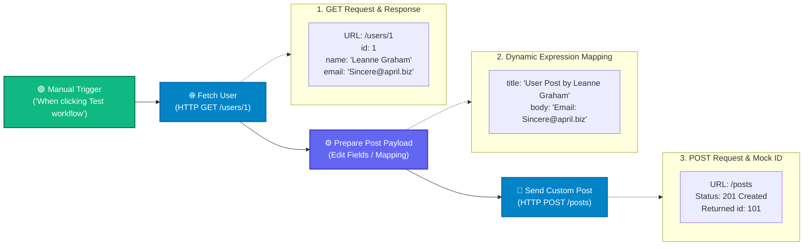

# Topic 11: HTTP Request Node - Fetch and Send API Data

> **Institution:** Tayana Academy | LMS Assessment  
> **Topic:** N8N Hands-On Beginner | Topic 11: HTTP Request Node - Fetch and Send API Data  
> **Workflow Name:** `Topic 11 HTTP Request Node Assessment`  
> **Target Audience:** Trainee / Employee  
> **Difficulty Level:** Beginner  
> **Platform Version:** n8n version 1.0.0 or higher  
> **Student:** Abhishek Nikam (`abhishek.n@tayanasolutions.com`)  
> **Repository:** [n8n-assessments](https://github.com/3OOM/n8n-assessments)  

---

## 1. Assessment Overview & Objectives

This practical assessment evaluates the learner's proficiency in configuring and utilizing the **HTTP Request** node in n8n to interface with external REST APIs. In modern automation pipelines, systems frequently consume upstream data from one external service, normalize or restructure the payload, and submit the enriched data to another external endpoint. 

The workflow demonstrates:
1. Fetching external user data using an **HTTP GET** request to a public REST endpoint.
2. Inspecting and validating structured JSON responses using JSON, Table, and Schema output views.
3. Transforming and preparing dynamic JSON payloads using the **Edit Fields (Set)** node with n8n expression mapping (`{{ $json.name }}` and `{{ $json.email }}`).
4. Submitting a structured **HTTP POST** request with dynamic JSON body mapping.
5. Verifying successful response handling, including validating the returned mock resource identifier (`id: 101`).

### Key Deliverables in this Package:
1. **`README.md`**: Comprehensive technical documentation covering architecture, endpoint specifications, node parameters, expressions, delivery verification, and LMS submission notes.
2. **`Topic_11_HTTP_Request_Node_Assessment.json`**: Official exportable n8n workflow file containing the complete 4-node sequence with pre-pinned test execution output and zero private credentials.
3. **`README.pdf`**: Print-ready, professionally styled PDF document generated directly from this documentation.

---

## 2. Workflow Architecture & Data Flow

The complete API integration workflow executes sequentially across 4 nodes:



### Data Pipeline Lifecycle:
1. **Trigger:** Manual execution initiated from the n8n canvas.
2. **Retrieve:** `Fetch User` executes a `GET` request to `https://jsonplaceholder.typicode.com/users/1`, parsing the incoming JSON payload into structured root fields (`id`, `name`, `username`, `email`, `address`, `phone`, `website`, `company`).
3. **Transform:** `Prepare Post Payload` extracts `name` and `email` using expressions, generating a clean output item with `title` and `body`.
4. **Submit:** `Send Custom Post` executes a `POST` request to `https://jsonplaceholder.typicode.com/posts` transmitting the mapped JSON body and receiving confirmation with `id: 101`.

---

## 3. Node Specifications & Detailed Configuration

### Node 1: When clicking ‘Test workflow’ (Manual Trigger)
- **Node Label:** `When clicking ‘Test workflow’`
- **Node Type:** `n8n-nodes-base.manualTrigger` (typeVersion: `1`)
- **Purpose:** Initiates the workflow run on demand for isolated testing and end-to-end evaluation.

### Node 2: Fetch User (HTTP Request - GET)
- **Node Label:** `Fetch User`
- **Node Type:** `n8n-nodes-base.httpRequest` (typeVersion: `4.2`)
- **Method:** `GET`
- **URL:** `https://jsonplaceholder.typicode.com/users/1`
- **Authentication:** `None`
- **Response Format:** Automatic JSON Parsing (`JSON`)
- **Captured Fields:**
  - `id`: `1`
  - `name`: `"Leanne Graham"`
  - `email`: `"Sincere@april.biz"`

### Node 3: Prepare Post Payload (Edit Fields)
- **Node Label:** `Prepare Post Payload`
- **Node Type:** `n8n-nodes-base.set` (typeVersion: `3.4`)
- **Assignments:**
  | Field Name | Type | Value / Dynamic Expression | Evaluated Output Sample |
  | :--- | :--- | :--- | :--- |
  | `title` | `String` | `=User Post by {{ $json.name }}` | `"User Post by Leanne Graham"` |
  | `body` | `String` | `=Email: {{ $json.email }}` | `"Email: Sincere@april.biz"` |

### Node 4: Send Custom Post (HTTP Request - POST)
- **Node Label:** `Send Custom Post`
- **Node Type:** `n8n-nodes-base.httpRequest` (typeVersion: `4.2`)
- **Method:** `POST`
- **URL:** `https://jsonplaceholder.typicode.com/posts`
- **Authentication:** `None`
- **Send Body:** Enabled (`true`)
- **Body Content Type:** `JSON`
- **JSON Body Expression:**
  ```json
  ={
    "title": "{{ $json.title }}",
    "body": "{{ $json.body }}"
  }
  ```
- **Returned Server Response:**
  ```json
  {
    "title": "User Post by Leanne Graham",
    "body": "Email: Sincere@april.biz",
    "id": 101
  }
  ```

---

## 4. Assessment Tasks & Step-by-Step Walkthrough

### Exercise 1 – Create the HTTP Request Workflow
- Created a fresh blank workflow canvas.
- Renamed the workflow precisely to:
  ```text
  Topic 11 HTTP Request Node Assessment
  ```
- Added and connected the 4 nodes in the required sequential chain:
  `Manual Trigger` ➔ `Fetch User` ➔ `Prepare Post Payload` ➔ `Send Custom Post`.

### Exercise 2 – Configure and Execute the GET Request
- In `Fetch User`, set **Method** to `GET` and **URL** to `https://jsonplaceholder.typicode.com/users/1`.
- Verified **Authentication** is set to `None`.
- Executed the single node using **Test step**.
- Verified that the response is received with status `200 OK` and automatically parsed into JSON attributes.

### Exercise 3 – Inspect and Validate the GET Response
- Inspected the returned payload using JSON, Table, and Schema view modes.
- Confirmed root properties:
  - `id` (Number): `1`
  - `name` (String): `"Leanne Graham"`
  - `email` (String): `"Sincere@april.biz"`

### Exercise 4 – Prepare the Dynamic POST Payload
- Configured `Prepare Post Payload` with two string fields:
  - `title` = `=User Post by {{ $json.name }}`
  - `body` = `=Email: {{ $json.email }}`
- Executed the step and inspected the output:
  - Verified `title` resolves cleanly to `"User Post by Leanne Graham"`.
  - Verified `body` resolves cleanly to `"Email: Sincere@april.biz"`.

### Exercise 5 – Configure the POST Request
- In `Send Custom Post`, set **Method** to `POST` and **URL** to `https://jsonplaceholder.typicode.com/posts`.
- Enabled **Send Body** with **Body Content Type** set to `JSON`.
- Mapped the payload dynamically using:
  ```json
  ={
    "title": "{{ $json.title }}",
    "body": "{{ $json.body }}"
  }
  ```
- Verified that no hardcoded title or email strings exist in the HTTP request node.

### Exercise 6 – Execute and Verify the Complete Workflow
- Executed the full workflow using **Test workflow**.
- All 4 nodes displayed green checkmark success indicators.
- Inspected the final output of `Send Custom Post`:
  - Verified status code `201 Created`.
  - Confirmed the response echoed back the submitted `title` and `body`.
  - Verified the server-generated resource ID: `id: 101`.

### Exercise 7 & 8 – Export, Document, and Prepare Submission
- Exported the complete workflow JSON as [`Topic_11_HTTP_Request_Node_Assessment.json`](./Topic_11_HTTP_Request_Node_Assessment.json).
- Generated publication-grade PDF [`README.pdf`](./README.pdf).
- Updated centralized assessment index at `3OOM/n8n-assessments`.

---

## 5. Output Verification & Multi-View Inspection

### 1. GET Response Payload (`Fetch User`)
```json
{
  "id": 1,
  "name": "Leanne Graham",
  "username": "Bret",
  "email": "Sincere@april.biz",
  "address": {
    "street": "Kulas Light",
    "suite": "Apt. 556",
    "city": "Gwenborough",
    "zipcode": "92998-3874",
    "geo": {
      "lat": "-37.3159",
      "lng": "81.1496"
    }
  },
  "phone": "1-770-736-8031 x56442",
  "website": "hildegard.org",
  "company": {
    "name": "Romaguera-Crona",
    "catchPhrase": "Multi-layered client-server neural-net",
    "bs": "harness real-time e-markets"
  }
}
```

### 2. Intermediate Payload (`Prepare Post Payload`)
```json
{
  "title": "User Post by Leanne Graham",
  "body": "Email: Sincere@april.biz"
}
```

### 3. Final POST Server Response (`Send Custom Post`)
```json
{
  "title": "User Post by Leanne Graham",
  "body": "Email: Sincere@april.biz",
  "id": 101
}
```

### Multi-View Inspection Matrix

| View Mode | What Evaluator Observes | Verification Criteria Met |
| :--- | :--- | :--- |
| **Table View** | Columns `title`, `body`, and `id` (`101`) clearly visible in tabular grid. | Confirms tabular representation of response data. |
| **JSON View** | Clean JSON response with status 201 created and generated ID `101`. | Validates proper JSON object format and dynamic resolution. |
| **Schema View** | • `title`: `string`<br>• `body`: `string`<br>• `id`: `number` | Confirms strict type adherence from the REST API. |

---

## 6. Technical Insights: GET vs. POST in n8n

| Feature / Dimension | HTTP GET (`Fetch User`) | HTTP POST (`Send Custom Post`) |
| :--- | :--- | :--- |
| **Primary Intent** | Safe, idempotent retrieval of existing resources. | Creation or submission of a new resource on the server. |
| **Request Body** | Does not contain a body payload. | Contains a structured request payload (JSON, form-data, etc.). |
| **n8n Configuration** | Method `GET`, URL specified, Send Body disabled. | Method `POST`, Send Body enabled, Content Type `JSON`. |
| **Expected Response** | Returns requested entity (HTTP `200 OK`). | Echoes created resource + newly minted ID (HTTP `201 Created`). |
| **Idempotence** | Calling multiple times yields identical data. | Calling multiple times may create distinct new records. |

---

## 7. Security & API Hygiene Guidelines

- **Public Endpoints:** The assessment utilizes `{JSON} Placeholder` (`jsonplaceholder.typicode.com`), a public mock REST API that requires no authentication headers or tokens.
- **Zero Secrets Policy:** No passwords, bearer tokens, or API keys are stored in the exported workflow file or documentation.
- **Network Resilience:** The workflow relies on standard HTTPS outbound connectivity over port 443. In enterprise environments behind proxy firewalls, ensure `jsonplaceholder.typicode.com` is whitelisted.

---

## 8. Practical Assessment Checklist

- [x] Workflow created and saved with exact name: **`Topic 11 HTTP Request Node Assessment`**.
- [x] Manual Trigger configured as starting entry point.
- [x] `Fetch User` HTTP Request node configured with `GET` method.
- [x] GET endpoint configured as `https://jsonplaceholder.typicode.com/users/1`.
- [x] GET response received and parsed automatically as JSON.
- [x] Identified key response fields: `id` (1), `name` ("Leanne Graham"), `email` ("Sincere@april.biz").
- [x] `Prepare Post Payload` node configured using dynamic expressions.
- [x] `title` field dynamically resolves from `=User Post by {{ $json.name }}`.
- [x] `body` field dynamically resolves from `=Email: {{ $json.email }}`.
- [x] `Send Custom Post` HTTP Request node configured with `POST` method.
- [x] POST endpoint configured as `https://jsonplaceholder.typicode.com/posts`.
- [x] Dynamic JSON body mapped using `{{ $json.title }}` and `{{ $json.body }}`.
- [x] Complete workflow executes sequentially without errors (100% green indicators).
- [x] Final POST response contains submitted values and returned mock resource id (`101`).
- [x] Workflow JSON exported (`Topic_11_HTTP_Request_Node_Assessment.json`).
- [x] Publication-ready PDF documentation generated (`README.pdf`).
- [x] Verified zero credentials, tokens, or private secrets exposed.
- [x] Pushed all deliverables to public GitHub repository.

---

## 9. LMS Submission Description & Assessor Notes

> **Copy and paste the text below directly into the LMS Description field when submitting:**

```text
================================================================================
TAYANA ACADEMY LMS SUBMISSION | TOPIC 11: HTTP REQUEST NODE - FETCH AND SEND API DATA
================================================================================
Student Name: Abhishek Nikam
Student Email: abhishek.n@tayanasolutions.com
Workflow Name: Topic 11 HTTP Request Node Assessment
GitHub Repository: https://github.com/3OOM/n8n-assessments/tree/main/topic-11-http-request-node

1. WORKFLOW IMPLEMENTATION SUMMARY:
- Constructed an end-to-end REST API integration pipeline across 4 nodes:
  Manual Trigger -> Fetch User (GET) -> Prepare Post Payload (Edit Fields) -> Send Custom Post (POST).
- "Fetch User" (HTTP Request GET):
  * Endpoint: https://jsonplaceholder.typicode.com/users/1
  * Retrieves user entity with id (1), name ("Leanne Graham"), and email ("Sincere@april.biz").
  * Automatic JSON parsing verified.
- "Prepare Post Payload" (Edit Fields / Set):
  * title (String): "=User Post by {{ $json.name }}" -> "User Post by Leanne Graham"
  * body (String): "=Email: {{ $json.email }}" -> "Email: Sincere@april.biz"
- "Send Custom Post" (HTTP Request POST):
  * Endpoint: https://jsonplaceholder.typicode.com/posts
  * Send Body: Enabled (JSON)
  * Dynamically maps {{ $json.title }} and {{ $json.body }} into outgoing JSON payload.

2. DYNAMIC EXPRESSION MAPPING & RESOLUTION:
- Zero hardcoded recipient or post information; all values are resolved dynamically from the upstream GET request output.
- Expression evaluation verified using n8n inline preview and verified against downstream node inputs.

3. EXECUTION & RESPONSE VERIFICATION:
- Executed the complete workflow sequentially with 100% green checkmark status indicators.
- Verified final response from Send Custom Post:
  * Status: 201 Created
  * Title: "User Post by Leanne Graham"
  * Body: "Email: Sincere@april.biz"
  * Mock Resource ID returned: 101

4. SECURITY & HYGIENE:
- Public mock REST API tested with zero authentication requirements.
- Strictly sanitized: no passwords, tokens, or private secrets exist in the exported workflow JSON or documentation.

5. ASSUMPTIONS & NOTES FOR ASSESSOR:
- Assumes outbound HTTPS internet access to jsonplaceholder.typicode.com.
- Resource ID 101 is the standard mock resource ID returned by JSONPlaceholder upon successful POST creation.
================================================================================
```
