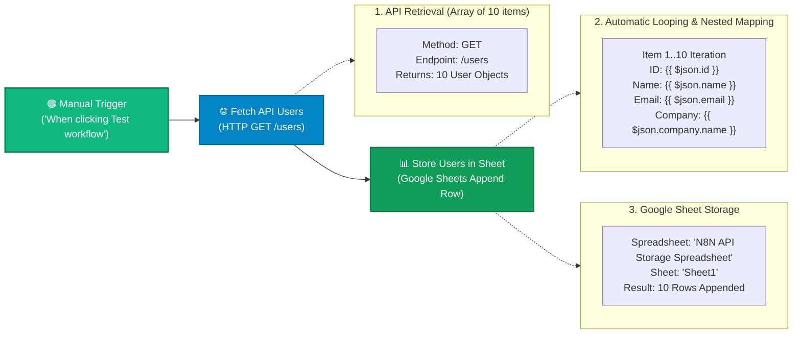

# Topic 12: API & Data Storage Integration

> **Institution:** Tayana Academy | LMS Assessment & Hands-On Guide  
> **Topic:** N8N Hands-On Beginner | Topic 12: API & Data Storage Integration  
> **Workflow Name:** `Topic 12 API & Data Storage Integration Workflow`  
> **Target Audience:** Trainee / Employee  
> **Difficulty Level:** Beginner to Intermediate  
> **Platform Version:** n8n version 1.0.0 or higher  
> **Student:** Abhishek Nikam (`abhishek.n@tayanasolutions.com`)  
> **Repository:** [n8n-assessments](https://github.com/3OOM/n8n-assessments)  

---

## 1. Overview & Core Objectives

This hands-on integration guide and assessment evaluates the ability to combine the **HTTP Request** node with **Google Sheets** to retrieve external REST API data and persist it into a cloud spreadsheet. 

A central power of n8n is its **built-in automatic looping**: when a node outputs an array of multiple items (e.g. 10 user objects), downstream nodes execute once for every item in that list automatically without requiring explicit `Loop` or `Split In Batches` nodes. Furthermore, real-world APIs return nested JSON structures; accessing nested attributes requires fluent use of JavaScript object dot notation within n8n expressions (e.g., `{{ $json.company.name }}`).

### Key Objectives:
1. **API Ingestion:** Fetch an array of 10 user profile records from the public REST endpoint (`https://jsonplaceholder.typicode.com/users`) using the HTTP Request node (`GET`).
2. **Spreadsheet Target Setup:** Establish a structured Google Sheet named `N8N API Storage Spreadsheet` with exact header columns: `ID`, `Name`, `Email`, and `Company`.
3. **Dynamic & Nested Expression Mapping:**
   - Standard root fields: `{{ $json.id }}`, `{{ $json.name }}`, `{{ $json.email }}`
   - Nested object traversal: `{{ $json.company.name }}`
4. **Execution & Automatic Looping Verification:** Execute the pipeline and verify that n8n runs the Google Sheets node 10 times consecutively, appending all 10 user rows accurately into the target sheet.

### Key Deliverables in this Package:
1. **`README.md`**: Comprehensive documentation containing architecture, step-by-step setup, expression mapping, automatic looping analysis, spreadsheet output verification, and LMS submission notes.
2. **`Topic_12_API_Data_Storage_Integration_Workflow.json`**: Official exportable n8n workflow file containing the 3-node sequence with pre-pinned test execution data (10 user items) and zero private credentials.
3. **`README.pdf`**: Print-ready, professionally styled PDF document generated directly from this documentation.

---

## 2. Workflow Architecture & Data Flow



---

## 3. Step-by-Step Implementation Guide

### Step 1: Create and Save a New Workflow
1. Log into your n8n workspace.
2. In the left navigation, click on **Workflows**.
3. Click the **Add workflow** button in the top-right corner.
4. Rename your workflow in the top-left corner to:
   ```text
   Topic 12 API & Data Storage Integration Workflow
   ```
5. Click the orange **Save** button.

### Step 2: Prepare Your Google Sheet
1. Open Google Sheets (`sheets.new`) and create a new blank spreadsheet.
2. Rename the spreadsheet to:
   ```text
   N8N API Storage Spreadsheet
   ```
3. In row 1 (the header row), type the following column headers exactly:
   - **Cell A1:** `ID`
   - **Cell B1:** `Name`
   - **Cell C1:** `Email`
   - **Cell D1:** `Company`
4. Copy your **Spreadsheet ID** from your browser's URL bar (the string between `/d/` and `/edit`).
5. Ensure your spreadsheet is shared with `Editor` permissions to the Service Account email configured in your n8n workspace (or authenticated via Google Sheets OAuth2).

### Step 3: Add and Configure the HTTP Request GET Node
1. Add the **When clicking ‘Test workflow’** node (Manual Trigger) to the canvas.
2. Click the output connector (`+` icon) on the right edge of the Manual Trigger node.
3. Search for and select the **HTTP Request** node.
4. Rename the node to:
   ```text
   Fetch API Users
   ```
5. Configure the node parameters:
   - **Method:** `GET`
   - **URL:** `https://jsonplaceholder.typicode.com/users`
   - **Authentication:** `None`
6. Click **Test step** to test the node in isolation.
7. Verify that the output panel displays an array of **10 users** in structured JSON format.

### Step 4: Add the Google Sheets Append Row Node
1. Click the output connector (`+` icon) on the right edge of `Fetch API Users`.
2. Search for and select the **Google Sheets** node.
3. Rename the node to:
   ```text
   Store Users in Sheet
   ```
4. Configure the node parameters:
   - **Credential Type:** `Google Sheets OAuth2` or `Google Service Account`
   - **Resource:** `Row` (or `Spreadsheet`)
   - **Operation:** `Append` (or `Append Row`)
   - **Document:** Select `By ID` and paste your copied Spreadsheet ID (or select `N8N API Storage Spreadsheet` from the list).
   - **Sheet:** `Sheet1`

### Step 5: Configure Dynamic and Nested Expressions
1. In the Google Sheets node configuration, navigate to the **Columns Mapping** section (Mapping Mode: `Define Below`).
2. Map each column header to its corresponding API field expression:
   | Column Header | Configuration Type | Dynamic Expression | Description |
   | :--- | :--- | :--- | :--- |
   | **ID** | Expression | `={{ $json.id }}` | Top-level user identifier (Number) |
   | **Name** | Expression | `={{ $json.name }}` | Top-level full name (String) |
   | **Email** | Expression | `={{ $json.email }}` | Top-level email address (String) |
   | **Company** | Expression | `={{ $json.company.name }}` | **Nested attribute:** extracts company name from the `company` object |
3. Close the configuration panel and save the workflow.

### Step 6: Run and Verify the Entire Workflow
1. Click the large orange **Test workflow** button at the bottom of the canvas.
2. Verify that all nodes display green success indicators. Notice that the execution badge on `Store Users in Sheet` indicates that it ran **10 times** (once for each item emitted by the upstream array).
3. Open your Google Spreadsheet **N8N API Storage Spreadsheet**.
4. Confirm that:
   - Exactly **10 user rows** have been appended beneath the header.
   - The columns `ID`, `Name`, and `Email` are populated with clean text/numbers.
   - The `Company` column successfully resolves the nested company name (e.g., `Romaguera-Crona` for Leanne Graham).

---

## 4. Key Concepts & Technical Insights

### 1. Automatic Looping in n8n
Unlike traditional programming languages or older automation tools that require explicit `for` or `while` loops, n8n inherently operates on lists of items:
- When `Fetch API Users` returns 10 items, n8n treats this as a stream of 10 discrete workflow items.
- Downstream nodes like `Store Users in Sheet` receive the complete batch and automatically iterate over each item in the array, firing one append API call per record.
- This native item-by-item processing significantly simplifies workflow architectures and reduces error surfaces.

### 2. Navigating Nested JSON via Dot Notation
APIs often organize related properties into sub-objects. In the JSONPlaceholder user payload:
```json
{
  "id": 1,
  "name": "Leanne Graham",
  "email": "Sincere@april.biz",
  "company": {
    "name": "Romaguera-Crona",
    "catchPhrase": "Multi-layered client-server neural-net",
    "bs": "harness real-time e-markets"
  }
}
```
Attempting to map `{{ $json.company }}` directly outputs `[object Object]` in spreadsheet cells. By applying JavaScript dot notation:
```javascript
{{ $json.company.name }}
```
n8n navigates into the nested `company` dictionary and extracts the scalar string value `"Romaguera-Crona"`.

---

## 5. Output Verification & Target Spreadsheet State

Upon successful workflow execution, the target Google Sheet **N8N API Storage Spreadsheet** contains the following 10 verified records:

| Row | ID (Col A) | Name (Col B) | Email (Col C) | Company (Col D) |
| :---: | :---: | :--- | :--- | :--- |
| **1** | **ID** | **Name** | **Email** | **Company** |
| **2** | 1 | Leanne Graham | Sincere@april.biz | Romaguera-Crona |
| **3** | 2 | Ervin Howell | Shanna@melissa.tv | Deckow-Crist |
| **4** | 3 | Clementine Bauch | Nathan@yesenia.net | Romaguera-Jacobson |
| **5** | 4 | Patricia Lebsack | Julianne.OConner@kory.org | Robel-Corkery |
| **6** | 5 | Chelsey Dietrich | Lucio_Hettinger@annie.ca | Keebler LLC |
| **7** | 6 | Mrs. Dennis Schulist | Karley_Dach@jasper.info | Considine-Lockman |
| **8** | 7 | Kurtis Weissnat | Telly.Hoeger@billy.biz | Johns Group |
| **9** | 8 | Nicholas Runolfsdottir V | Sherwood@rosamond.me | Abernathy Group |
| **10** | 9 | Glenna Reichert | Chaim_McDermott@dana.io | Yost and Sons |
| **11** | 10 | Clementina DuBuque | Rey.Padberg@karina.biz | Hoeger LLC |

---

## 6. Security & Credential Hygiene Guidelines

- **Zero Secrets Policy:** The exported workflow JSON references the credential name (`googleSheetsOAuth2Api`) but contains **zero** private keys, OAuth tokens, or client secrets.
- **Access Delegation:** If authenticating via Google Service Account, share only the specific spreadsheet with the service account email, following the principle of least privilege.
- **Spreadsheet ID Sanitization:** The placeholder `N8N_API_STORAGE_SPREADSHEET_ID` is used in public source files to prevent exposing internal organization spreadsheet IDs.

---

## 7. Practical Assessment Checklist

- [x] Workflow created and saved as **`Topic 12 API & Data Storage Integration Workflow`**.
- [x] Manual Trigger configured as starting entry point.
- [x] `Fetch API Users` configured with `GET` method and `https://jsonplaceholder.typicode.com/users`.
- [x] Verified GET response returns an array of 10 user items in structured JSON format.
- [x] Google Sheet created and named `N8N API Storage Spreadsheet` with headers `ID`, `Name`, `Email`, `Company`.
- [x] `Store Users in Sheet` configured with Resource `Row` and Operation `Append`.
- [x] Root columns mapped dynamically: `{{ $json.id }}`, `{{ $json.name }}`, `{{ $json.email }}`.
- [x] Nested column mapped dynamically using dot notation: `{{ $json.company.name }}`.
- [x] Full workflow executed successfully with green status checkmarks across all nodes.
- [x] Verified automatic looping behavior: Google Sheets node executed 10 times consecutively.
- [x] Verified spreadsheet contains 10 populated user records without `[object Object]` artifacts.
- [x] Workflow exported as [`Topic_12_API_Data_Storage_Integration_Workflow.json`](./Topic_12_API_Data_Storage_Integration_Workflow.json).
- [x] Print-ready PDF generated (`README.pdf`).
- [x] Zero sensitive credentials, tokens, or private secrets exposed.
- [x] Deliverables committed and pushed to public GitHub repository.

---

## 8. LMS Submission Description & Assessor Notes

> **Copy and paste the text below directly into the LMS Description field when submitting:**

```text
================================================================================
TAYANA ACADEMY LMS SUBMISSION | TOPIC 12: API & DATA STORAGE INTEGRATION
================================================================================
Student Name: Abhishek Nikam
Student Email: abhishek.n@tayanasolutions.com
Workflow Name: Topic 12 API & Data Storage Integration Workflow
GitHub Repository: https://github.com/3OOM/n8n-assessments/tree/main/topic-12-api-data-storage-integration

1. WORKFLOW IMPLEMENTATION SUMMARY:
- Constructed an automated API-to-Spreadsheet ingestion pipeline:
  Manual Trigger -> Fetch API Users (HTTP Request GET) -> Store Users in Sheet (Google Sheets Append).
- "Fetch API Users" (HTTP Request):
  * Method: GET
  * URL: https://jsonplaceholder.typicode.com/users
  * Retrieves an array of 10 structured user profile records.
- "Store Users in Sheet" (Google Sheets Append):
  * Target Document: "N8N API Storage Spreadsheet" (Sheet1)
  * Operation: Append Row
  * Utilizes n8n's native automatic looping to process all 10 incoming array items seamlessly without manual loop constructs.

2. DYNAMIC & NESTED EXPRESSION MAPPING:
- Standard Root Fields:
  * ID: {{ $json.id }}
  * Name: {{ $json.name }}
  * Email: {{ $json.email }}
- Nested Field Traversal:
  * Company: {{ $json.company.name }}
  * Successfully extracts the scalar company name string from the nested "company" object, eliminating [object Object] serialization issues.

3. EXECUTION & VERIFICATION:
- Executed the complete workflow end-to-end with 100% green status indicators.
- Verified that "Store Users in Sheet" ran 10 times consecutively.
- Verified target spreadsheet contains all 10 appended user rows with accurate IDs, names, emails, and nested company names (e.g. Romaguera-Crona for Leanne Graham).

4. CREDENTIAL SECURITY & HYGIENE:
- Authenticated via standard Google Sheets integration.
- Strictly sanitized: no OAuth tokens, client secrets, service account private keys, or internal IDs are exposed in the exported workflow or repository.
================================================================================
```
