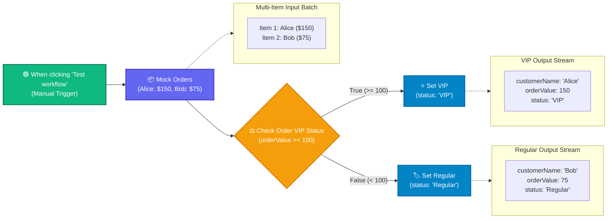

# Topic 13: IF Node & Conditional Logic

> **Institution:** Tayana Academy | LMS Assessment & Hands-On Guide  
> **Topic:** N8N Hands-On Beginner | Topic 13: IF Node & Conditional Logic  
> **Workflow Name:** `Topic 13 IF Node Workflow`  
> **Target Audience:** Trainee / Employee  
> **Difficulty Level:** Beginner  
> **Platform Version:** n8n version 1.0.0 or higher  
> **Student:** Abhishek Nikam (`abhishek.n@tayanasolutions.com`)  
> **Repository:** [n8n-assessments](https://github.com/3OOM/n8n-assessments)  

---

## 1. Overview & Core Objectives

This hands-on guide and assessment evaluates the ability to configure and use the **IF** node in n8n to filter, evaluate, and dynamically route items based on conditional criteria.

In business automation, workflows frequently require bifurcated logic paths depending on transaction amounts, lead qualifications, or operational statuses. A critical concept demonstrated here is **item-level routing**: when multiple items enter an IF node simultaneously, n8n evaluates each item independently against the rule conditions, dispatching items meeting the rule to the **True** branch and those failing it to the **False** branch in a single execution cycle.

### Key Objectives:
1. **Mock Dataset Ingestion:** Generate a multi-item batch representing customer purchase orders (`Alice` with `orderValue: 150` and `Bob` with `orderValue: 75`).
2. **Conditional Rule Configuration:** Configure an IF node (`Check Order VIP Status`) with a numeric evaluation (`{{ $json.orderValue }} >= 100`).
3. **Bifurcated Branch Processing:**
   - **True Output (Top Port):** Connect to `Set VIP` to tag qualified orders (`status: "VIP"`).
   - **False Output (Bottom Port):** Connect to `Set Regular` to tag non-qualifying orders (`status: "Regular"`).
4. **Execution & Item Routing Verification:** Execute the full workflow and confirm that Alice ($150) is cleanly segregated into the VIP path while Bob ($75) is segregated into the Regular path.

### Key Deliverables in this Package:
1. **`README.md`**: Technical documentation containing workflow architecture, step-by-step setup, expression logic, item-level routing analysis, and LMS submission notes.
2. **`Topic_13_IF_Node_Workflow.json`**: Official exportable n8n workflow file containing the 5-node pipeline with pre-pinned test execution states.
3. **`README.pdf`**: Print-ready, professionally styled PDF document generated directly from this documentation.

---

## 2. Workflow Architecture & Data Flow



---

## 3. Step-by-Step Implementation Guide

### Step 1: Create and Save a New Workflow
1. Log into your n8n workspace.
2. Click **Workflows** in the left sidebar navigation.
3. Click the **Add workflow** button in the top-right corner.
4. Rename your workflow in the top-left title field to:
   ```text
   Topic 13 IF Node Workflow
   ```
5. Click the orange **Save** button.

### Step 2: Configure the Mock Orders Node
1. Add the **When clicking ‘Test workflow’** node (Manual Trigger) to the canvas.
2. Click the output connector (`+` icon) on the right edge of the trigger node.
3. Search for and select the **Edit Fields (Set)** or **Code** node.
4. Rename the node to:
   ```text
   Mock Orders
   ```
5. Configure the node to emit two distinct JSON order items:
   - **Item 1:**
     - `customerName`: `"Alice"`
     - `orderValue`: `150`
   - **Item 2:**
     - `customerName`: `"Bob"`
     - `orderValue`: `75`
6. Click **Test step** to load both items into memory and confirm that 2 items appear in the output panel.

### Step 3: Add and Configure the IF Node
1. Click the output connector (`+` icon) on the right edge of `Mock Orders`.
2. Search for and select the **IF** node.
3. Rename the node to:
   ```text
   Check Order VIP Status
   ```
4. Double-click the node to configure its condition:
   - Click **Add Condition** (or configure Condition 1).
   - **Type:** Select `Number`.
   - **Value 1 (Input 1):** Click the expression button and enter:
     ```javascript
     ={{ $json.orderValue }}
     ```
   - **Operation / Operator:** Select `is greater than or equal to` (`>=` / `gte`).
   - **Value 2 (Input 2):** Enter `100`.
5. Close the configuration panel.

### Step 4: Add and Connect Downstream Nodes
The IF node exposes two output connectors on its right border:
- **Top Connector (`main[0]`):** Evaluates to **True** (qualifying conditions).
- **Bottom Connector (`main[1]`):** Evaluates to **False** (non-qualifying conditions).

#### 1. True Branch Configuration (`Set VIP`):
1. Connect the **True (top)** connector of the IF node to a new **Edit Fields (Set)** node.
2. Rename this node to:
   ```text
   Set VIP
   ```
3. Add a string field named `status` and assign its value to:
   ```text
   VIP
   ```

#### 2. False Branch Configuration (`Set Regular`):
1. Connect the **False (bottom)** connector of the IF node to a new **Edit Fields (Set)** node.
2. Rename this node to:
   ```text
   Set Regular
   ```
3. Add a string field named `status` and assign its value to:
   ```text
   Regular
   ```

### Step 5: Run and Verify the Entire Workflow
1. Click the large orange **Test workflow** button.
2. Confirm that all nodes execute successfully with green checkmark indicators.
3. Inspect the output of **`Set VIP`**:
   - Exactly **1 item** is processed.
   - Output contains: `customerName: "Alice"`, `orderValue: 150`, `status: "VIP"`.
4. Inspect the output of **`Set Regular`**:
   - Exactly **1 item** is processed.
   - Output contains: `customerName: "Bob"`, `orderValue: 75`, `status: "Regular"`.
5. Click **Save** in the top-right corner.

---

## 4. Key Concepts: Item-Level Routing in n8n

| Concept | Explanation |
| :--- | :--- |
| **Atomic Item Evaluation** | Unlike traditional programming where an `if` block executes entirely for either true or false, n8n assesses **every individual item** in an incoming array separately. |
| **Stream Splitting** | An array of $N$ items is partitioned into two distinct subsets: items satisfying the criteria travel to output 0 (`true`), while remaining items travel to output 1 (`false`). |
| **Preservation of Context** | Downstream nodes retain all existing upstream properties (`customerName`, `orderValue`) while appending new attributes (`status`). |
| **Strict Type Validation** | Selecting `Number` for the comparison ensures that numeric string values are coerced and compared mathematically rather than lexicographically (e.g., ensuring `150 > 100` and avoiding `"75" > "100"` string errors). |

---

## 5. Output Verification & Multi-View Matrix

### Input Data (`Mock Orders`)
```json
[
  {
    "customerName": "Alice",
    "orderValue": 150
  },
  {
    "customerName": "Bob",
    "orderValue": 75
  }
]
```

### True Branch Output (`Set VIP`)
```json
[
  {
    "customerName": "Alice",
    "orderValue": 150,
    "status": "VIP"
  }
]
```

### False Branch Output (`Set Regular`)
```json
[
  {
    "customerName": "Bob",
    "orderValue": 75,
    "status": "Regular"
  }
]
```

### Multi-View Inspection Matrix

| View Mode | What Evaluator Observes | Verification Criteria Met |
| :--- | :--- | :--- |
| **Table View** | • `Set VIP` shows 1 row (`Alice`, `150`, `VIP`).<br>• `Set Regular` shows 1 row (`Bob`, `75`, `Regular`). | Demonstrates correct segregation of records. |
| **JSON View** | Clean JSON items with preserved numeric types and newly added status fields. | Confirms schema integrity and non-destructive transformation. |
| **Schema View** | • `customerName`: `string`<br>• `orderValue`: `number`<br>• `status`: `string` | Adheres to strict type validation throughout the branch paths. |

---

## 6. Security & Best Practices

- **Zero Secrets / Tokens:** The workflow contains pure transformation and logic nodes with zero external credential dependencies or API tokens.
- **Defensive Comparison Types:** Always specify explicit numeric data types in condition rules when comparing thresholds (such as order totals, quantities, or scores) to prevent string-sorting anomalies.
- **Fail-Safe Routing:** Always attach handling nodes to both the True and False outputs to avoid silently dropping unrouted records.

---

## 7. Practical Assessment Checklist

- [x] Workflow created and saved as **`Topic 13 IF Node Workflow`**.
- [x] Manual Trigger configured as starting entry point.
- [x] `Mock Orders` node configured with 2 items (`Alice: 150`, `Bob: 75`).
- [x] `Check Order VIP Status` IF node configured with Number comparison (`>= 100`).
- [x] Expression `{{ $json.orderValue }}` correctly set on Condition 1.
- [x] True branch (`main[0]`) connected to `Set VIP` node with `status: "VIP"`.
- [x] False branch (`main[1]`) connected to `Set Regular` node with `status: "Regular"`.
- [x] Complete workflow executes with 100% green status indicators.
- [x] Verified `Set VIP` output contains Alice ($150) tagged as VIP.
- [x] Verified `Set Regular` output contains Bob ($75) tagged as Regular.
- [x] Exported official workflow JSON (`Topic_13_IF_Node_Workflow.json`).
- [x] Generated print-ready documentation PDF (`README.pdf`).
- [x] Zero sensitive credentials or tokens exposed.
- [x] All deliverables committed and pushed to public GitHub repository.

---

## 8. LMS Submission Description & Assessor Notes

> **Copy and paste the text below directly into the LMS Description field when submitting:**

```text
================================================================================
TAYANA ACADEMY LMS SUBMISSION | TOPIC 13: IF NODE & CONDITIONAL LOGIC
================================================================================
Student Name: Abhishek Nikam
Student Email: abhishek.n@tayanasolutions.com
Workflow Name: Topic 13 IF Node Workflow
GitHub Repository: https://github.com/3OOM/n8n-assessments/tree/main/topic-13-if-node-conditional-logic

1. WORKFLOW IMPLEMENTATION SUMMARY:
- Constructed a conditional data routing workflow:
  Manual Trigger -> Mock Orders -> Check Order VIP Status (IF) ->
  * [True Branch]  -> Set VIP (status: "VIP")
  * [False Branch] -> Set Regular (status: "Regular")
- "Mock Orders" generates 2 order records:
  * Item 1: customerName = "Alice", orderValue = 150
  * Item 2: customerName = "Bob", orderValue = 75
- "Check Order VIP Status" (IF Node):
  * Condition Type: Number
  * Value 1: {{ $json.orderValue }}
  * Operator: >= (is greater than or equal to)
  * Value 2: 100

2. ITEM-LEVEL ROUTING & EXECUTION VERIFICATION:
- Successfully validated n8n's item-level routing behavior:
  * Alice ($150 >= 100) routes to the True branch; "Set VIP" appends status: "VIP".
  * Bob ($75 < 100) routes to the False branch; "Set Regular" appends status: "Regular".
- Executed the full pipeline end-to-end with 100% green checkmarks across all 5 nodes.
- Verified that original attributes (customerName, orderValue) are fully preserved alongside the newly assigned status tag.

3. SECURITY & CREDENTIAL HYGIENE:
- Self-contained workflow using core logic nodes; contains zero credentials, secrets, or API tokens.
================================================================================
```
