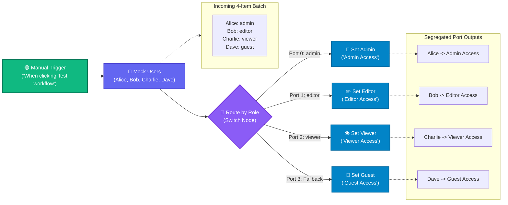

# Topic 14: Switch Node & Workflow Routing

> **Institution:** Tayana Academy | LMS Assessment & Hands-On Guide  
> **Topic:** N8N Hands-On Beginner | Topic 14: Switch Node & Workflow Routing  
> **Workflow Name:** `Topic 14 Switch Node Workflow`  
> **Target Audience:** Trainee / Employee  
> **Difficulty Level:** Beginner to Intermediate  
> **Platform Version:** n8n version 1.0.0 or higher  
> **Student:** Abhishek Nikam (`abhishek.n@tayanasolutions.com`)  
> **Repository:** [n8n-assessments](https://github.com/3OOM/n8n-assessments)  

---

## 1. Overview & Core Objectives

This hands-on guide and assessment evaluates the ability to configure and use the **Switch** node in n8n to implement multi-branch decision trees and route workflow items across $N$-way output paths based on multiple conditional criteria.

While the binary **IF** node is optimal for dual-outcome routing (True vs. False), real-world business systems require multi-state dispatching (e.g., user permission tiers, ticket severities, regional routing, order fulfillment statuses). Chaining multiple IF nodes results in unwieldy, deeply nested cascades ("pyramids of doom"). The **Switch** node solves this by evaluating rules in parallel or sequential order and dispatching items to designated output ports (0, 1, 2, ..., $N$), complete with an essential **Fallback Route** for unhandled exceptions.

### Key Objectives:
1. **Multi-Role Ingestion:** Generate a 4-item dataset representing different user access roles:
   - Alice (`role: "admin"`)
   - Bob (`role: "editor"`)
   - Charlie (`role: "viewer"`)
   - Dave (`role: "guest"`)
2. **Multi-Branch Rule Configuration:** Configure the Switch node (`Route by Role`) to evaluate `{{ $json.role }}`:
   - Output Port 0: `admin`
   - Output Port 1: `editor`
   - Output Port 2: `viewer`
   - Output Port 3 (Fallback / Default): Catches unmatched roles (e.g. `guest`)
3. **Specialized Downstream Action Handling:** Attach dedicated **Edit Fields (Set)** nodes to each of the 4 output ports to tag the account with appropriate privileges (`Admin Access`, `Editor Access`, `Viewer Access`, `Guest Access`).
4. **Execution & Routing Verification:** Execute the entire workflow and confirm that every user record routes accurately to its intended destination port without data loss.

### Key Deliverables in this Package:
1. **`README.md`**: Comprehensive documentation covering architecture, step-by-step setup, switch rule configuration, fallback handling, output matrices, and LMS submission notes.
2. **`Topic_14_Switch_Node_Workflow.json`**: Official exportable n8n workflow file containing the 6-node pipeline with pre-pinned test execution states.
3. **`README.pdf`**: Print-ready, professionally styled PDF document generated directly from this documentation.

---

## 2. Workflow Architecture & Data Flow



---

## 3. Step-by-Step Implementation Guide

### Step 1: Create and Save a New Workflow
1. Log into your n8n workspace.
2. In the left navigation, click on **Workflows**.
3. Click the **Add workflow** button in the top-right corner.
4. Rename your workflow in the top-left corner to:
   ```text
   Topic 14 Switch Node Workflow
   ```
5. Click the orange **Save** button.

### Step 2: Configure the Mock Users Node
1. Add the **When clicking ‘Test workflow’** node (Manual Trigger) to the canvas grid.
2. Click the output connector (`+` icon) on the right edge of the Manual Trigger node.
3. Search for and select the **Edit Fields (Set)** or **Code** node.
4. Rename the node to:
   ```text
   Mock Users
   ```
5. Configure the node to emit 4 distinct user records:
   - **User 1:** `username: "Alice"`, `role: "admin"`
   - **User 2:** `username: "Bob"`, `role: "editor"`
   - **User 3:** `username: "Charlie"`, `role: "viewer"`
   - **User 4:** `username: "Dave"`, `role: "guest"`
6. Click **Test step** to load all 4 records into memory and verify the array output.

### Step 3: Add and Configure the Switch Node
1. Click the output connector (`+` icon) on the right edge of `Mock Users`.
2. Search for and select the **Switch** node.
3. Rename the node to:
   ```text
   Route by Role
   ```
4. Double-click the node to configure its parameters:
   - **Mode:** Select `Rules`.
   - **Routing Rules:**
     - **Rule 1 (Output Port 0):**
       - Value 1 (Left Value): `={{ $json.role }}`
       - Type: `String`
       - Operation: `equals`
       - Value 2 (Right Value): `admin`
     - **Rule 2 (Output Port 1):**
       - Value 1 (Left Value): `={{ $json.role }}`
       - Type: `String`
       - Operation: `equals`
       - Value 2 (Right Value): `editor`
     - **Rule 3 (Output Port 2):**
       - Value 1 (Left Value): `={{ $json.role }}`
       - Type: `String`
       - Operation: `equals`
       - Value 2 (Right Value): `viewer`
   - **Fallback Route (Default):** Toggle **Fallback Output** to `On` / `Extra Output`. This designates **Output Port 3** as the catch-all branch for any record that does not match Rules 1, 2, or 3.
5. Close the configuration panel. Notice that `Route by Role` now displays **4 distinct output port dots** (labeled 0, 1, 2, and 3).

### Step 4: Add and Connect Downstream Nodes
Connect an **Edit Fields (Set)** node to each of the 4 output ports:

1. **Port 0 (Admin Access):**
   - Connect Port 0 to a new Edit Fields node named `Set Admin`.
   - Add field `status` (String) with value: `Admin Access`.
2. **Port 1 (Editor Access):**
   - Connect Port 1 to a new Edit Fields node named `Set Editor`.
   - Add field `status` (String) with value: `Editor Access`.
3. **Port 2 (Viewer Access):**
   - Connect Port 2 to a new Edit Fields node named `Set Viewer`.
   - Add field `status` (String) with value: `Viewer Access`.
4. **Port 3 (Guest Access / Fallback):**
   - Connect Port 3 to a new Edit Fields node named `Set Guest`.
   - Add field `status` (String) with value: `Guest Access`.

### Step 5: Run and Verify the Entire Workflow
1. Click the large orange **Test workflow** button.
2. Confirm that all 6 nodes execute successfully and turn green.
3. Inspect each destination node's output:
   - **`Set Admin`:** Contains 1 item (`Alice`, `role: "admin"`, `status: "Admin Access"`).
   - **`Set Editor`:** Contains 1 item (`Bob`, `role: "editor"`, `status: "Editor Access"`).
   - **`Set Viewer`:** Contains 1 item (`Charlie`, `role: "viewer"`, `status: "Viewer Access"`).
   - **`Set Guest`:** Contains 1 item (`Dave`, `role: "guest"`, `status: "Guest Access"` via Fallback).
4. Click **Save** in the top-right corner.

---

## 4. Technical Architecture: Switch Node vs. Cascading IF Nodes

| Dimension | Cascading IF Nodes | n8n Switch Node |
| :--- | :--- | :--- |
| **Node Complexity** | Requires $N-1$ separate nodes chained through False connectors. | A single, unified node manages all $N$ branches. |
| **Canvas Readability** | Disorganized, stair-stepped layout that sprawls across the canvas. | Clean, centralized hub with clearly indexed output ports. |
| **Execution Overhead** | High: Each item must traverse multiple conditional checks sequentially. | Low: Items are evaluated in a single centralized pass. |
| **Fallback Handling** | Hidden at the end of the final chained False port. | Built-in, dedicated Fallback/Default output port. |
| **Maintainability** | Adding a new condition requires rewiring existing connections. | Simply click **Add Rule** inside the Switch panel. |

---

## 5. Output Verification & Multi-View Matrix

### Input Payload (`Mock Users`)
```json
[
  { "username": "Alice", "role": "admin" },
  { "username": "Bob", "role": "editor" },
  { "username": "Charlie", "role": "viewer" },
  { "username": "Dave", "role": "guest" }
]
```

### Destination Node Outputs

#### Port 0 (`Set Admin`)
```json
[
  {
    "username": "Alice",
    "role": "admin",
    "status": "Admin Access"
  }
]
```

#### Port 1 (`Set Editor`)
```json
[
  {
    "username": "Bob",
    "role": "editor",
    "status": "Editor Access"
  }
]
```

#### Port 2 (`Set Viewer`)
```json
[
  {
    "username": "Charlie",
    "role": "viewer",
    "status": "Viewer Access"
  }
]
```

#### Port 3 (`Set Guest` - Fallback)
```json
[
  {
    "username": "Dave",
    "role": "guest",
    "status": "Guest Access"
  }
]
```

### Multi-View Inspection Matrix

| View Mode | What Evaluator Observes | Verification Criteria Met |
| :--- | :--- | :--- |
| **Table View** | Each of the 4 downstream nodes shows a single row with `username`, `role`, and assigned `status`. | Proves complete 1-to-1 segregation across all 4 ports. |
| **JSON View** | Clean JSON objects preserving upstream properties with added `status` attributes. | Validates payload integrity and non-destructive routing. |
| **Schema View** | • `username`: `string`<br>• `role`: `string`<br>• `status`: `string` | Confirms strict type adherence across all output paths. |

---

## 6. Security & Credential Hygiene Guidelines

- **Self-Contained Routing:** The workflow executes entirely with core n8n transformation nodes; no external credentials, API keys, or database connections are required.
- **Fail-Safe Fallback:** Always enable the Fallback Route to prevent unexpected input values from silently disappearing from the workflow pipeline.
- **Zero Secrets Policy:** No passwords, tokens, or private endpoints are included in the workflow export or documentation.

---

## 7. Practical Assessment Checklist

- [x] Workflow created and saved as **`Topic 14 Switch Node Workflow`**.
- [x] Manual Trigger configured as starting entry point.
- [x] `Mock Users` node configured with 4 user profiles (`admin`, `editor`, `viewer`, `guest`).
- [x] Switch node configured with string evaluation on `{{ $json.role }}`.
- [x] Rule 1 configured for `admin` ➔ Output Port 0.
- [x] Rule 2 configured for `editor` ➔ Output Port 1.
- [x] Rule 3 configured for `viewer` ➔ Output Port 2.
- [x] Fallback route enabled ➔ Output Port 3.
- [x] Dedicated Set nodes connected to all 4 output ports:
  - `Set Admin` (status: `"Admin Access"`)
  - `Set Editor` (status: `"Editor Access"`)
  - `Set Viewer` (status: `"Viewer Access"`)
  - `Set Guest` (status: `"Guest Access"`)
- [x] Entire workflow executes successfully with 100% green checkmark indicators.
- [x] Verified each destination node processed exactly 1 designated item.
- [x] Workflow JSON exported as [`Topic_14_Switch_Node_Workflow.json`](./Topic_14_Switch_Node_Workflow.json).
- [x] Publication-ready PDF documentation generated (`README.pdf`).
- [x] Zero sensitive credentials or tokens exposed.
- [x] All deliverables committed and pushed to public GitHub repository.

---

## 8. LMS Submission Description & Assessor Notes

> **Copy and paste the text below directly into the LMS Description field when submitting:**

```text
================================================================================
TAYANA ACADEMY LMS SUBMISSION | TOPIC 14: SWITCH NODE & WORKFLOW ROUTING
================================================================================
Student Name: Abhishek Nikam
Student Email: abhishek.n@tayanasolutions.com
Workflow Name: Topic 14 Switch Node Workflow
GitHub Repository: https://github.com/3OOM/n8n-assessments/tree/main/topic-14-switch-node-multi-branch-routing

1. WORKFLOW IMPLEMENTATION SUMMARY:
- Constructed a multi-branch decision workflow:
  Manual Trigger -> Mock Users -> Route by Role (Switch) ->
  * [Port 0: admin]    -> Set Admin (status: "Admin Access")
  * [Port 1: editor]   -> Set Editor (status: "Editor Access")
  * [Port 2: viewer]   -> Set Viewer (status: "Viewer Access")
  * [Port 3: Fallback] -> Set Guest (status: "Guest Access")
- "Mock Users" generates 4 user items:
  * Alice (role: "admin")
  * Bob (role: "editor")
  * Charlie (role: "viewer")
  * Dave (role: "guest")
- "Route by Role" (Switch Node):
  * Mode: Rules
  * Expression: {{ $json.role }}
  * Rules configured for admin, editor, and viewer
  * Fallback Route enabled on extra output port 3 to capture unhandled roles (guest).

2. MULTI-BRANCH ROUTING & EXECUTION VERIFICATION:
- Executed the full pipeline end-to-end with 100% green status indicators across all 6 nodes.
- Verified that n8n partitioned the 4 incoming items accurately across all 4 destination ports:
  * Port 0: Alice tagged with "Admin Access"
  * Port 1: Bob tagged with "Editor Access"
  * Port 2: Charlie tagged with "Viewer Access"
  * Port 3: Dave caught by Fallback and tagged with "Guest Access"
- Verified that original attributes (username, role) remain intact alongside the newly assigned status field.

3. SECURITY & CREDENTIAL HYGIENE:
- Self-contained workflow using core logic nodes; contains zero credentials, secrets, or API tokens.
================================================================================
```
