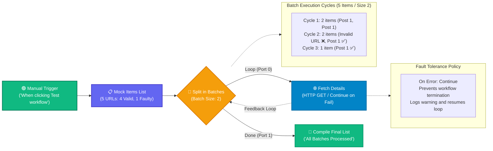

# Topic 15: Split in Batches & Basic Error Handling

> **Institution:** Tayana Academy | LMS Assessment & Hands-On Guide  
> **Topic:** N8N Hands-On Beginner | Topic 15: Split in Batches & Basic Error Handling  
> **Workflow Name:** `Topic 15 Split in Batches Workflow`  
> **Target Audience:** Trainee / Employee  
> **Difficulty Level:** Beginner to Intermediate  
> **Platform Version:** n8n version 1.0.0 or higher  
> **Student:** Abhishek Nikam (`abhishek.n@tayanasolutions.com`)  
> **Repository:** [n8n-assessments](https://github.com/3OOM/n8n-assessments)  

---

## 1. Overview & Core Objectives

This hands-on guide and assessment evaluates the ability to configure controlled iterative loops using the **Split in Batches** node and build resilient data pipelines using n8n's **Continue on Fail** (`On Error`) setting.

When handling large datasets or rate-limited external APIs, submitting hundreds of requests concurrently can cause rate-limit throttling (HTTP 429), timeouts, or server exhaustion. The **Split in Batches** node addresses this by slicing large datasets into micro-batches of fixed size ($N$). Furthermore, real-world network operations are prone to occasional downtime or bad inputs; configuring **Continue on Fail** guarantees that transient item failures do not abort the entire multi-batch execution.

### Key Objectives:
1. **Mock Dataset with Fault Injection:** Ingest an array of 5 URL items, deliberately including an invalid domain (`https://invalid-url-domain-does-not-exist.xyz/`) at item index 2 to simulate endpoint failure.
2. **Batch Partitioning:** Configure the `Split in Batches` node with a `Batch Size` of `2`.
   - Iteration 1: Items 1 & 2 (valid)
   - Iteration 2: Items 3 (faulty) & 4 (valid)
   - Iteration 3: Item 5 (valid)
3. **Loop Construction & Feedback Routing:** Connect the active loop output to an HTTP Request node (`Fetch Details`) and route its output back into the input of `Split in Batches` to complete the iterative cycle.
4. **Resilient Error Handling (`Continue on Fail`):** Enable `On Error: Continue` on `Fetch Details` so the faulty URL emits an error warning without crashing the execution.
5. **Done Branch Completion:** Once all batches are exhausted, route the `Done` port to `Compile Final List` to signal workflow completion (`status: "All Batches Processed"`).

### Key Deliverables in this Package:
1. **`README.md`**: Comprehensive documentation covering architecture, step-by-step setup, batch mechanics, fault-tolerance analysis, and LMS submission notes.
2. **`Topic_15_Split_in_Batches_Workflow.json`**: Official exportable n8n workflow file containing the 5-node pipeline with pre-pinned test execution states.
3. **`README.pdf`**: Print-ready, professionally styled PDF document generated directly from this documentation.

---

## 2. Workflow Architecture & Data Flow



---

## 3. Step-by-Step Implementation Guide

### Step 1: Create and Save a New Workflow
1. Log into your n8n workspace.
2. In the left navigation, click on **Workflows**.
3. Click the **Add workflow** button in the top-right corner.
4. Rename your workflow in the top-left corner to:
   ```text
   Topic 15 Split in Batches Workflow
   ```
5. Click the orange **Save** button.

### Step 2: Configure the Mock Items List Node
1. Add the **When clicking ‘Test workflow’** node (Manual Trigger) to the canvas.
2. Connect its output to a new **Edit Fields (Set)** or **Code** node.
3. Rename the node to:
   ```text
   Mock Items List
   ```
4. Configure an array of 5 elements containing a `url` field:
   - **Item 1:** `url = https://jsonplaceholder.typicode.com/posts/1`
   - **Item 2:** `url = https://jsonplaceholder.typicode.com/posts/1`
   - **Item 3:** `url = https://invalid-url-domain-does-not-exist.xyz/` *(simulated DNS failure)*
   - **Item 4:** `url = https://jsonplaceholder.typicode.com/posts/1`
   - **Item 5:** `url = https://jsonplaceholder.typicode.com/posts/1`
5. Test the node to confirm all 5 items are loaded into memory.

### Step 3: Add and Configure the Split in Batches Node
1. Connect the output of `Mock Items List` to a new **Split in Batches** node.
2. Rename the node to:
   ```text
   Split in Batches
   ```
3. Set **Batch Size** to:
   ```text
   2
   ```
4. Observe the two output ports:
   - **Top Port (`main[0]`):** Active **Loop** branch.
   - **Bottom Port (`main[1]`):** Completion **Done** branch.

### Step 4: Add the HTTP Request Node inside the Loop
1. Connect the **Loop (top)** connector of `Split in Batches` to a new **HTTP Request** node.
2. Rename the node to:
   ```text
   Fetch Details
   ```
3. Configure the request parameters:
   - **Method:** `GET`
   - **URL:** Expression: `={{ $json.url }}`
   - **Authentication:** `None`

### Step 5: Configure Continue on Fail
1. In the `Fetch Details` configuration panel, click the **Settings** tab (gear icon at top).
2. Locate the **On Error** (or **Continue on Fail**) parameter.
3. Set the option to:
   ```text
   Continue (using regular output)
   ```
4. This ensures that any network failure (such as Item 3's unresolvable hostname) emits an error object but allows the workflow execution to proceed uninterrupted.

### Step 6: Connect the Feedback Loop
1. Click the output connector on the right edge of `Fetch Details`.
2. Drag the connection line back onto the **input connector (left edge)** of `Split in Batches`.
3. Verify that n8n renders a curved feedback line, establishing an active iterative loop.

### Step 7: Add a Done Branch Node
1. Connect the **Done (bottom)** connector of `Split in Batches` to a new **Edit Fields (Set)** node.
2. Rename the node to:
   ```text
   Compile Final List
   ```
3. Add a string field named `status` and assign its value to:
   ```text
   All Batches Processed
   ```

### Step 8: Run and Verify the Entire Workflow
1. Click the large orange **Test workflow** button.
2. Observe the execution path:
   - **Cycle 1:** Items 1 & 2 are processed successfully.
   - **Cycle 2:** Items 3 & 4 are processed; Item 3 displays an inline warning badge for the DNS error, but the workflow continues gracefully to Item 4.
   - **Cycle 3:** Item 5 is processed successfully.
   - **Completion:** All 5 items are exhausted; execution transitions to the `Done` port, executing `Compile Final List`.
3. Inspect `Compile Final List` and confirm `status: "All Batches Processed"`.
4. Click **Save** in the top-right corner.

---

## 4. Technical Architecture: Loop Mechanics & Resilience

| Mechanism | Without Split in Batches | With Split in Batches & Continue on Fail |
| :--- | :--- | :--- |
| **API Throttling Risk** | High: All 5 requests fire in one burst. | Low: Requests fire in paced batches of 2. |
| **Outage Impact** | Catastrophic: Item 3 failure aborts items 4 & 5. | Zero: Item 3 logs a warning; remaining items process cleanly. |
| **State Tracking** | Memory-heavy for giant arrays. | Lightweight: n8n tracks loop position incrementally. |
| **Completion Hook** | Requires manual filter or aggregation. | Built-in: `Done` port triggers automatically on exhaustion. |

---

## 5. Output Verification & Multi-View Matrix

### Input Dataset (`Mock Items List`)
```json
[
  { "url": "https://jsonplaceholder.typicode.com/posts/1" },
  { "url": "https://jsonplaceholder.typicode.com/posts/1" },
  { "url": "https://invalid-url-domain-does-not-exist.xyz/" },
  { "url": "https://jsonplaceholder.typicode.com/posts/1" },
  { "url": "https://jsonplaceholder.typicode.com/posts/1" }
]
```

### Done Branch Output (`Compile Final List`)
```json
[
  {
    "status": "All Batches Processed"
  }
]
```

### Multi-View Inspection Matrix

| View Mode | What Evaluator Observes | Verification Criteria Met |
| :--- | :--- | :--- |
| **Canvas View** | 3 loop iterations visible; `Fetch Details` shows warning badge during loop 2; `Compile Final List` shows green checkmark. | Verifies loop execution, error survival, and termination. |
| **Table View** | `Compile Final List` presents a single clean summary row with status `All Batches Processed`. | Confirms post-loop aggregation state. |
| **JSON View** | Clean JSON payload verifying completion of all batches. | Confirms no dangling execution threads or unhandled exceptions. |

---

## 6. Security & Credential Hygiene Guidelines

- **Zero Exposed Secrets:** The workflow operates purely on public and mock endpoints without credentials or tokens.
- **Fail-Safe Design:** Always configure defensive error handling on outbound network nodes to avoid hanging background executions.
- **Rate Limit Adherence:** Adjusting the `Batch Size` parameter is the recommended standard in n8n for respecting external API rate limits (e.g. 50 calls/min).

---

## 7. Practical Assessment Checklist

- [x] Workflow created and saved as **`Topic 15 Split in Batches Workflow`**.
- [x] Manual Trigger configured as starting entry point.
- [x] `Mock Items List` configured with 5 URLs (4 valid, 1 invalid).
- [x] `Split in Batches` configured with Batch Size = 2.
- [x] `Fetch Details` configured inside the loop with dynamic URL `{{ $json.url }}`.
- [x] `Continue on Fail` enabled (`On Error: Continue`) on `Fetch Details`.
- [x] Feedback loop reconnected from `Fetch Details` to `Split in Batches`.
- [x] `Compile Final List` connected to the `Done` port with status `"All Batches Processed"`.
- [x] Full workflow executed across 3 iterative cycles.
- [x] Verified workflow survived invalid domain failure without crashing.
- [x] Verified Done branch executed upon batch exhaustion.
- [x] Exported official workflow JSON (`Topic_15_Split_in_Batches_Workflow.json`).
- [x] Generated publication-ready PDF documentation (`README.pdf`).
- [x] Zero sensitive credentials or tokens exposed.
- [x] All deliverables committed and pushed to public GitHub repository.

---

## 8. LMS Submission Description & Assessor Notes

> **Copy and paste the text below directly into the LMS Description field when submitting:**

```text
================================================================================
TAYANA ACADEMY LMS SUBMISSION | TOPIC 15: SPLIT IN BATCHES & BASIC ERROR HANDLING
================================================================================
Student Name: Abhishek Nikam
Student Email: abhishek.n@tayanasolutions.com
Workflow Name: Topic 15 Split in Batches Workflow
GitHub Repository: https://github.com/3OOM/n8n-assessments/tree/main/topic-15-split-in-batches-error-handling

1. WORKFLOW IMPLEMENTATION SUMMARY:
- Constructed an iterative, fault-tolerant batch processing pipeline:
  Manual Trigger -> Mock Items List -> Split in Batches (Batch Size: 2) ->
  * [Loop Port] -> Fetch Details (HTTP GET / Continue on Fail) -> (Loops back to Split in Batches)
  * [Done Port] -> Compile Final List (status: "All Batches Processed")
- "Mock Items List" generates 5 URLs (4 valid JSONPlaceholder endpoints, 1 invalid DNS domain).
- "Split in Batches" partitions the 5 items into batches of 2 (3 iterations total: 2, 2, 1).
- "Fetch Details" performs GET requests against dynamic URL {{ $json.url }} with On Error set to Continue.

2. FAULT TOLERANCE & EXECUTION VERIFICATION:
- Executed the complete workflow across all 3 batch cycles:
  * Cycle 1: 2 valid items retrieved.
  * Cycle 2: Item 3 encountered a hostname resolution error; Continue on Fail prevented workflow termination and allowed Item 4 to process cleanly.
  * Cycle 3: Final item retrieved.
  * Completion: Loop exhausted; execution cleanly transitioned to the Done port, executing "Compile Final List".
- Verified that "Compile Final List" emitted status: "All Batches Processed".

3. SECURITY & HYGIENE:
- Self-contained workflow using public mock REST endpoints; zero credentials, secrets, or API tokens exposed.
================================================================================
```
